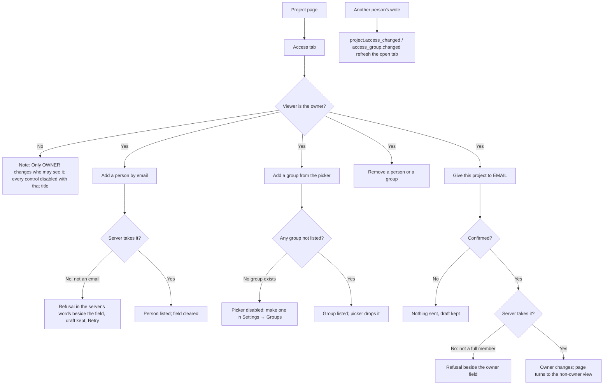
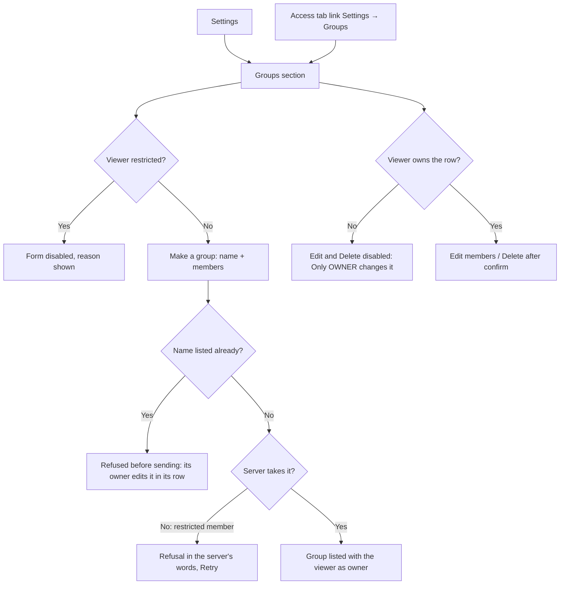

# Dogfood Report — INFRA-3862 t-a-4 (Access tab and Settings → Groups)

> Diff-scoped browser QA of the t-a-4 change against its base `5b0878fcad`. Run on 2026-11-16 with
> the `agent-browser` CLI against `bun run dispatch:local` (the real Go Dispatch, dev sign-in, its
> own database), signed in as the owner, as a non-owner full member and as a restricted member.

## Diff Summary

- A project page has an **Access** tab at `/projects/:key/access`: the owner, the visibility (read
  only, "Public"), the people and the groups the access list names, add and remove for each, and
  "Give this project to". Every control is disabled for anyone but the owner, with the reason on the
  page and as each control's `title`. Saves run in one mutation scope per project.
- **Settings → Groups** lists every group with its owner and members, makes one (name + members),
  and edits or deletes the viewer's own groups; another person's group has Edit and Delete disabled
  with the owner named as the reason. A restricted member's form is disabled with the reason shown.
- `project.access_changed` refreshes that project's Access tab and `access_group.changed` the group
  list (before this change both events threw in `eventRefreshTargets`).
- The e2e reset now empties `access_groups`, which no foreign key reaches.

## Personas

- **Project owner** — the person taking themselves out of the terminal, who owns a product end to
  end and decides who sees it — `STRATEGY.md`, Dispatch "Users".
- **Full member who is not the owner** — wants to see who has access and whom to ask — inferred.
- **Restricted member** (signed in from outside the company) — sees only what names them and cannot
  make a project or a group — inferred from the spec's R2 and R5.

No Compound Packs are declared (`packs-resolve.py`: no roots, no warnings).

## Flows Tested

## Test Matrix & Results

Screenshots are in the run's scratch directory (`ce-dogfood-acnXjb`), not in the repository.

| # | Flow | Journey / Scenario | Status | Issue | Fix | Commit |
|---|------|--------------------|--------|-------|-----|--------|
| 1 | Access | Owner opens CORE's Access tab: owner "alice (you)", Public, two people, one group (`01`) | Pass | - | - | - |
| 2 | Access | Owner adds `dave@example.com` and the group `design.team`; the field clears, the picker drops the group (`05`) | Pass | - | - | - |
| 3 | Access | Owner adds `bob`: the server's "\"bob\" is no email" shows under People with Retry, the draft stays (`04`) | Pass | - | - | - |
| 4 | Access | Owner gives CORE to a restricted member: confirm, then "an owner is a full member who has signed in" under the owner field (`06`) | Pass | - | - | - |
| 5 | Access | Owner gives CORE to bob: the note and every control's title read "Only bob, the project's owner, changes who may see it." (`07`) | Pass | - | - | - |
| 6 | Access | bob adds `erin@example.com` from another session; alice's open tab lists erin with no reload; alice makes group `qa` and the open picker offers it | Pass | - | - | - |
| 7 | Access | Remove a person and a group | Pass | - | - | - |
| 8 | Access | Restricted member opens WEB (owner carol, empty list): empty states and the disabled controls read clearly (`09`) | Pass | - | - | - |
| 9 | Groups | Owner's Settings → Groups: own groups editable, bob's `design.team` disabled (`03`) | Pass | - | - | - |
| 10 | Groups | Restricted member's Settings → Groups: "A restricted member cannot make a group." above a disabled form (`08`) | Pass | - | - | - |
| 11 | Groups | The Access tab's "Settings → Groups" link landed on `/settings#groups` at the top of Settings, with Groups 647 px below the fold (`10`); after the fix Groups is at the top of the view (`11`) | Fixed | Dead-end link | Section scrolls itself into view once listed | (this change) |
| 12 | Access | Phone width (390 px): the page is 390 px wide, nothing clipped, 44 px controls (`12`) | Pass | - | - | - |

Row 7 was driven by `e2e/project-access-ui.e2e.ts` against the real server in Chromium, not by
hand in this session.

## Pack Compliance

None: the repository declares no Compound Packs.

## What Was Fixed

### The Settings → Groups link did not reach Groups — (this change)
- **Symptom:** the link opened `/settings#groups` scrolled to the top; Groups started 647 px down,
  below Projects, so the link promised a section it did not show.
- **Root cause:** a React Router navigation scrolls to no fragment, and nothing on Settings read it.
- **Fix:** `packages/dispatch/web/src/features/settings/GroupsSection.tsx` scrolls its section into
  view once its list is drawn when the address names `#groups`.
- **Regression test:** `GroupsSection.test.tsx`, "an address naming #groups brings the section into
  view once its list is drawn" (failed with 0 calls before the fix, passes after).

### Found while writing the e2e row: groups survived the e2e reset
- **Symptom:** a retried row found the group its first attempt made.
- **Root cause:** `access_groups` is reached by no foreign key from a table `e2e/seed.ts` names.
- **Fix:** `packages/dispatch/e2e/seed.ts` names `access_groups`; its members follow by their key.
- **Regression test:** the e2e row itself begins by asserting "No groups yet." after a previous run
  left `crew` in the same database, and passed.

### Found while writing the panel: both access events threw in the event feed
- **Symptom:** `eventRefreshTargets` threw "document event is missing its artifact id" for
  `project.access_changed` and `access_group.changed`.
- **Fix:** `packages/dispatch/web/src/api/event-refresh.ts` refreshes the project's access and the
  group list.
- **Regression test:** two `test.each` rows in `web/src/__tests__/event-feed.test.ts`.

## Paper Cuts (by persona)

- **Full member who is not the owner** — the owner-only forms stay on the page, disabled, which is
  most of the tab — low — kept: the contract asks for each control disabled with its reason.
- **Project owner** — a long project name truncates in the header next to the tabs — low — not this
  change's (the header's own rule).

## Console Errors

None (`agent-browser errors` was empty after each scenario).

## Human Verifications

Not applicable: dev sign-in, no outside interaction.

## Decisions for a Human

None from this change. The restricted member could open every project's pages, because the read rule
is applied to reads in slice A3 (t-a-10, t-a-12 and after), not in this slice.

## Learnings

- A new route of `app.tsx` reaches four tables beside the router: `e2e/two-builds-routes.ts`, the
  two-builds walk's visits, `e2e/review-routes.ts` and the row map's real-stack reasons.
- A table no foreign key reaches from `e2e/seed.ts`'s list survives the reset silently.

### Pack candidates

None.

## Final Status

Every driven scenario passes; the one failure found is fixed with a regression test. The automated
suites' results are in the change's report.
