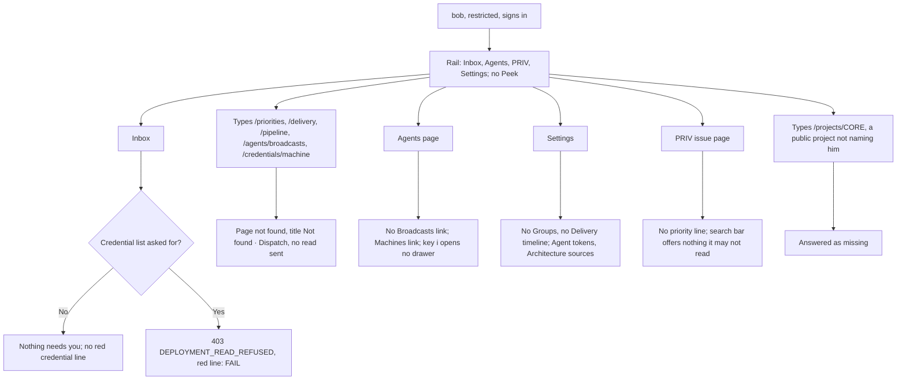
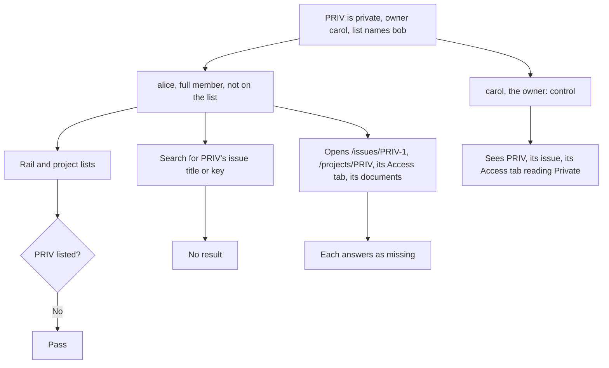
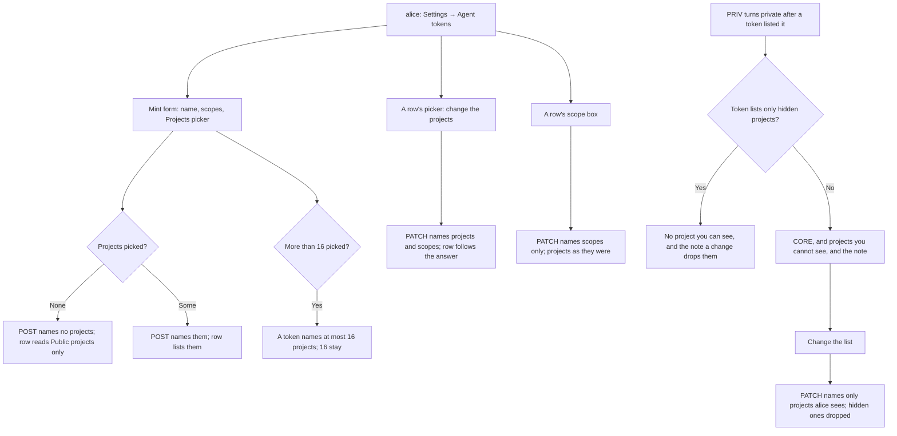
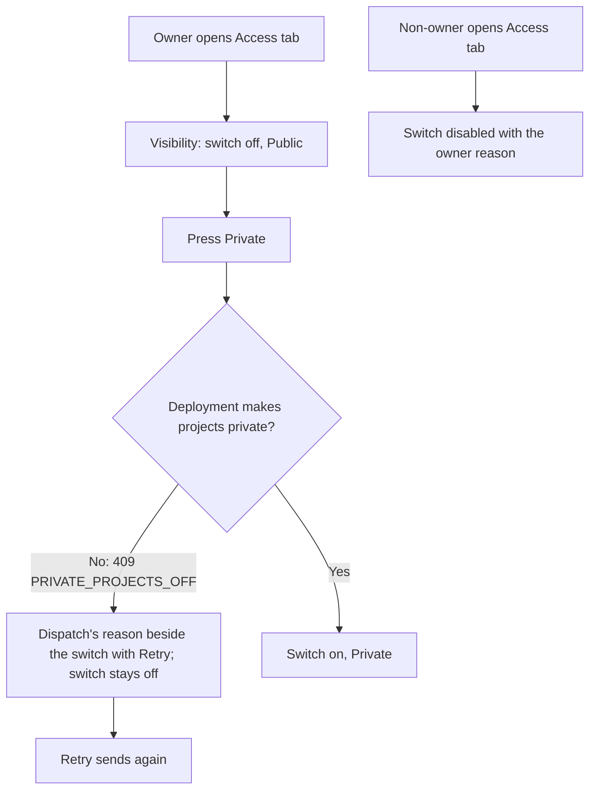
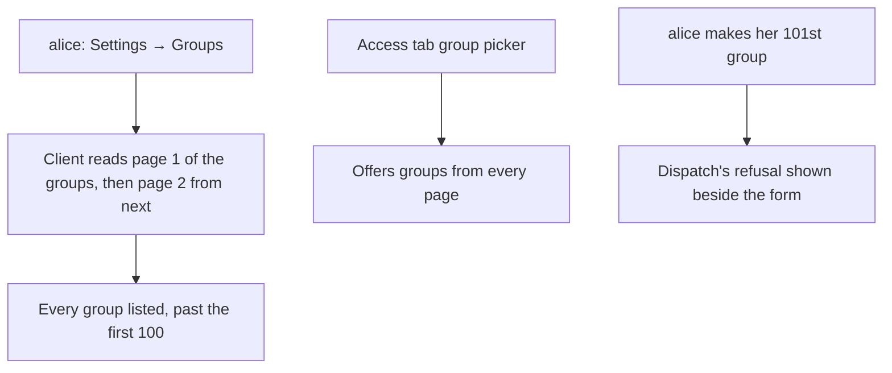

# Dogfood Report — INFRA-3862-private (slice A3, private projects)

> Diff-scoped browser QA of `INFRA-3862-private` at `6bdc68a75f` vs its pull request base
> `origin/INFRA-3862-access` (pull request #4177 is stacked on #4156). Generated by `ce-dogfood` on
> 2026-11-16. Driven with the `agent-browser` CLI against `bun run dispatch:local` (the real Go
> Dispatch, dev sign-in, a database of its own), signed in as a full member, a project's owner and
> a restricted member.

## Diff Summary

The branch merged `origin/main` once (`869c42979f`); the diff below is the branch against the merge
of its base with that `main` commit, so `main`'s own changes are left out.

- A **restricted member's** dashboard (`member_kind: "restricted"` from `/auth/whoami`) draws a rail
  of Inbox, Agents, their projects and Settings, with no Peek; Priorities, Delivery, Pipeline, the
  broadcasts and machine logins answer Page not found (`DeploymentPages` in `web/src/app.tsx`); and
  no page of theirs asks for a deployment row (`hooks/useRestrictedMember.ts`): the Inbox's
  credential list, the priorities, the new-issue settings, the groups and the delivery settings.
- The server binds every read to its reader's project clause, so a **private project** and its
  issues, documents and search hits answer as missing to a caller its access list does not let in.
- **Settings → Agent tokens** mints and edits the projects a token may use (at most 16), and a
  token whose list names projects hidden from the reader reads "No project you can see" or
  "X, and projects you cannot see", with a note that a change drops them.
- The owner's **Access tab** has a Private switch; a deployment that cannot make a project private
  refuses it (409 `PRIVATE_PROJECTS_OFF`), and the refusal shows beside the switch with Retry.
- **Settings → Groups** reads the group list page by page (`listAccessGroups` in
  `web/src/api/client.ts`), and an owner holds at most 100 groups.
- The access-change event descriptions no longer name the person or group changed.

## Personas

- **Project owner / full member** — the person taking themselves out of the terminal, who owns a
  product end to end and decides who sees it — `STRATEGY.md`, Dispatch "Users".
- **Restricted member** — a person from outside the company whom a project's access list names;
  reads only those projects and none of the deployment's own rows — inferred from the spec section
  the code cites (`dispatch://INFRA-3862/spec#b-r-cross-project-reads`) and the Access tab's copy.
- **Full member left off a private project** — must not learn the project exists — inferred from
  the same spec.

No Compound Packs are declared (`packs-resolve.py`: no roots, no warnings, no errors).

## Flows Tested

## Test Matrix & Results

| # | Flow | Journey / Scenario | Status | Issue | Fix | Commit |
|---|------|--------------------|--------|-------|-----|--------|
| 1 | Restricted | bob's rail at `/projects/PRIV` links `/`, `/agents`, `/projects/PRIV`, `/settings`; no Peek button (`01`) | Pass | - | - | - |
| 2 | Restricted | bob's Inbox reads "Nothing needs you"; no credential-request line; no `credential-requests` read sent (`02`) | Pass | - | - | - |
| 3 | Restricted | bob's `/priorities`, `/priorities/launch`, `/delivery`, `/pipeline`, `/agents/broadcasts`, the seeded broadcast and `/credentials/machine` each show "Page not found", title "Not found · Dispatch", and send no read of their own (`03`) | Pass | - | - | - |
| 4 | Restricted | bob's Agents page links Machines and no Broadcasts; key `i` opens no drawer (alice's opens the Inbox drawer: control) (`04`) | Pass | - | - | - |
| 5 | Restricted | bob's Settings draws Projects, Agent tokens, Live grants, Sign-ins, Repositories → Projects, Architecture sources; no Groups, no Delivery timeline (`05`) | Pass | - | - | - |
| 6 | Restricted | bob's PRIV-1 draws no `issue-advances` line (alice's CORE-1 draws one: control); the search bar on PRIV's issues answers "No results" and reads no new-issue settings (`06`) | Pass | - | - | - |
| 7 | Restricted | bob opened 14 pages (Inbox, Agents, Answers, Replies, Machines, his page, PRIV-1 and its Verification, PRIV, its Documents, a document, Access, Architecture, Settings): 152 API answers, all 200, no page error. Control: a `fetch('/api/v1/priorities')` from his page shows as `403 DEPLOYMENT_READ_REFUSED` in the same log | Pass | - | - | - |
| 8 | Restricted | bob's `/projects/CORE` and its Access tab read "Page not found", `/issues/CORE-1` "Issue not found … or you don't have access to it", as for an unknown key (`08`) | Pass | - | - | - |
| 9 | Restricted | bob at 390 px: header is Dispatch, Inbox, Menu (no Peek); the menu's rail is the same four links; page 390 px wide (alice's header has Peek: control) (`09`) | Pass | - | - | - |
| 10 | Private unseen | alice's rail: `/`, `/agents`, `/priorities`, `/delivery`, `/pipeline`, CORE, OPS, P01-P15, `/settings`; no PRIV anywhere on the page (`10`) | Pass | - | - | - |
| 11 | Private unseen | alice's Settings → Projects lists CORE, OPS, P01-P15 and no PRIV; the project bar (`g p`) finds nothing for "reef" (`11`) | Pass | - | - | - |
| 12 | Private unseen | alice's search for "reef" and "PRIV-1" answers "No results"; carol's finds the project, PRIV-1 and the document (control) (`12`) | Pass | - | - | - |
| 13 | Private unseen | alice's `/issues/PRIV-1`, `/projects/PRIV`, its Access tab, its Documents and `reef-survey` read exactly as `NOPE`'s do; the API answers are byte for byte those of an unknown key (`13`) | Pass | - | - | - |
| 14 | Private unseen | carol's rail lists PRIV; PRIV-1 opens; the Access tab's switch is on, reads "Private", enabled (`14`) | Pass | - | - | - |
| 15 | Tokens | alice names CORE and OPS in the mint form's picker; the POST body is `{name, projects: [CORE, OPS], scopes}`; the row reads "CORE, OPS" and the value is shown once (`15`) | Pass | - | - | - |
| 16 | Tokens | alice mints `public-only` with the picker untouched: the POST body names no `projects`; the row reads "Public projects only"; the list answer holds no `projects` | Pass | - | - | - |
| 17 | Tokens | alice changes `core-ops` to CORE and P01: one PATCH `{projects: [CORE, P01], scopes: [person, approve]}`; the row and the stored list follow | Pass | - | - | - |
| 18 | Tokens | alice clears and ticks a scope box of `core-ops`: each PATCH is `{scopes}` alone; the stored list stays CORE, P01 | Pass | - | - | - |
| 19 | Tokens | alice ticks a 17th project: Dispatch's cap holds (16 saved; the server refuses 17 with `400 TOKEN_PROJECTS_INPUT`), but "A token names at most 16 projects." was drawn below the scrolled rows and under the Clear footer, and not announced, so the press looked like it did nothing (`19`, `19b`); after the fix it shows in the pinned footer as an alert (`19c`) | Fixed | Refusal out of view | Error in the pinned footer, `role=alert` | `6346684216` |
| 20 | Tokens | after PRIV turned private, `reef-only` (PRIV) reads "No project you can see" and `reef-and-core` (CORE, PRIV) "CORE, and projects you cannot see", each with "A change here drops the projects you cannot see."; the list answer is `projects_hidden: true` with only CORE (`20`) | Pass | - | - | - |
| 21 | Tokens | adding OPS to `reef-and-core` sends `{projects: [CORE, OPS]}`, and the stored list becomes CORE, OPS: PRIV dropped, as the note says (pass). But `reef-only`, whose every project is hidden, cannot be made "Public projects only" from its picker: it opens with nothing ticked and no Clear, and a close with no change sends nothing; it takes a pick, a close, a reopen and Clear (two PATCHes) (`21a`) | Blocked (human decision) | All-hidden token cannot be reset in one step | See Decisions | - |
| 22 | Access | alice presses CORE's Private switch: PATCH `{visibility: private}` answers `409 PRIVATE_PROJECTS_OFF`; "this deployment cannot make a project private yet: nothing was changed" shows under the switch with Retry, as an alert; the switch stays off and reads Public; Retry sends the PATCH again and shows the same refusal (`22`) | Pass | - | - | - |
| 23 | Access | bob on PRIV's Access tab: the switch is on (Private), `aria-disabled`, titled and described by "Only carol@example.com, the project's owner, changes who may see it."; a press sends nothing (`23`) | Pass | - | - | - |
| 24 | Groups | alice's Settings → Groups sends `GET /api/v1/access-groups` then `?after=crew-99`, and lists all 103 groups, crew-00 … crew-99 then carol's zz-reef-a, -b, -c, whose Edit and Delete are disabled with the owner as reason (`24`) | Pass | - | - | - |
| 25 | Groups | CORE's Access tab reads both pages; its group picker offers 103 groups; adding `zz-reef-b` (page 2) sends `PUT …/access/groups/zz-reef-b` and lists it (`25`) | Pass | - | - | - |
| 26 | Groups | alice's 101st group (`crew-extra`) answers `400 CAP_EXCEEDED`; "an owner holds at most 100 groups: alice holds 100" shows under the form with Retry, the draft kept (`26`) | Pass | - | - | - |
| 27 | Events | The access-change event descriptions name no person or group | Skipped | No page shows a project-level event: `project.access_changed` reaches no issue's Activity tab, the one consumer of `activity-model.ts`; covered by `event-description.test.ts` and `event-feed.test.ts` only | - | - |

Status values: `Pending`, `Pass`, `Fixed`, `Skipped`, `Blocked (needs human verify)`, `Blocked (human decision)`.

Screenshots, by the number in each row, are in the run's scratch directory (`ce-dogfood-jbw6l8`),
not in the repository. Every row was driven in Chromium with `agent-browser`, one session per
person, against `bun run dispatch:local` on a database of its own.

**The seed** beyond `e2e/workspace.ts` (alice's CORE and OPS, issues, asks, the broadcast) went
through the routes as each person: carol (`carol@example.com`) made PRIV, named
`bob@outside.example` on its list, filed PRIV-1 and wrote the document `reef-survey`; alice made
P01-P15 and minted `reef-only` (PRIV) and `reef-and-core` (CORE, PRIV) while PRIV was public;
alice made 100 groups and carol 3. Two facts no route of this branch writes were written by SQL,
as the acceptance drivers write them: bob's `member_kind = 'restricted'`
(`e2e/acceptance/project-access.sh`'s `mark_restricted`), and PRIV private. The route was tried
first, as its owner: `PATCH /api/v1/projects/PRIV/access {visibility: private}` answered
`409 PRIVATE_PROJECTS_OFF`, so PRIV was made private by `update projects set visibility = 'private'
where key = 'PRIV'`, the stand-in `project-access.sh --private-by-sql` uses.

## Pack Compliance

None: the repository declares no Compound Packs.

## What Was Fixed

### A picker's refusal was out of view and not announced — `6346684216`
- **Symptom:** in Settings → Agent tokens, with 17 projects to choose from, ticking the
  seventeenth changed nothing on screen. "A token names at most 16 projects." was drawn after the
  rows, which scroll inside the popover: it sat below the row just pressed, under the pinned Clear
  footer (`19`, `19b`), and no screen reader heard it. Dispatch itself held the cap (16 saved; a
  PATCH naming 17 answers `400 TOKEN_PROJECTS_INPUT`).
- **Root cause:** `MultiSelect` rendered its `error` as a plain `
` between the scrolling
  listbox and the `sticky bottom-0` Clear footer, with no live role.
- **Fix:** `packages/dispatch/web/src/components/MultiSelect.tsx` draws the error inside the
  pinned footer, above Clear, as `role="alert"`. Every picker with an error (token projects, issue
  labels, components, the assignee filter) gets it; the labels picker's length error was replayed
  in the browser and shows in the footer.
- **Regression test:** `web/src/components/MultiSelect.test.tsx`, "an error is announced in the
  footer pinned below the rows, beside Clear": failed before the fix (no `alert` role), passes
  after; `AgentTokensSection.test.tsx`'s 16-project row and every other `MultiSelect` consumer's
  tests pass. Browser replay after `bun run build:web`: the alert is in view at 525-581 px, and
  `elementFromPoint` at its centre lands on it (`19c`).

## Paper Cuts (by persona)

- **Full member** — the refusal of a 17th project was out of view — sharp — fixed `6346684216`.
- **Full member** — a token whose every project is hidden cannot be set back to "Public
  projects only" from its picker in one step — medium — escalated (Decisions).
- **Project owner** — Retry is offered beside refusals this deployment always gives
  (`PRIVATE_PROJECTS_OFF`, the 100-group `CAP_EXCEEDED`), so a press repeats the same answer —
  low — deferred: the slice's contract asks for Retry beside the switch.
- **Project owner** — the refusal is Dispatch's sentence as sent, starting in lower case ("this
  deployment cannot make a project private yet: nothing was changed") — low — deferred: showing
  Dispatch's own reason verbatim is the intent.
- **Full member** — Settings → Groups draws all 103 groups inline, which pushes Agent tokens far
  down the page — low — deferred: the slice reads the list whole by design.

## Console Errors

None from the dashboard. `agent-browser console` held no warning or error from any session
(alice, bob, carol); its control fired (a `console.error` from the page was captured). The
`errors` control was inconclusive: a thrown error printed `✗` with no text, so uncaught page
errors are read from the console capture alone. Every non-2xx answer in the request logs was one
a scenario asked for: 404 for PRIV's and NOPE's keys, 409 `PRIVATE_PROJECTS_OFF`, 400
`CAP_EXCEEDED`, and the control `403 DEPLOYMENT_READ_REFUSED` of row 7.

## Human Verifications

Not applicable: dev sign-in, no outside interaction.

## Decisions for a Human

### A token whose every project is hidden cannot be reset to the public projects in one step
- **What's broken:** after PRIV turned private, alice's `reef-only` token (PRIV only) reads "No
  project you can see" with "A change here drops the projects you cannot see." Its picker opens
  with nothing ticked and no Clear, and a close with no change sends nothing, so the only way to
  "Public projects only" is to pick a project, close, reopen and Clear (two PATCHes), or to revoke
  and mint again. The token is inert meanwhile: a fresh token of alice's whose list was set to
  `{PRIV}` by SQL read `/api/v1/projects` as `[]` and public CORE-1 as 404 with its bearer; set to
  `{CORE}`, the same bearer read CORE-1 as 200, and a wrong bearer got 401 (controls).
- **Why escalated:** what one press should save for a hidden list is a product call (the
  picker's rule today is "a close with no change sends nothing"), and there are competing designs.
- **Options:** (a) show Clear in the picker when `projects_hidden` is true even with nothing
  ticked, and let that close send `projects: []` (small; bends the picker's no-change rule);
  (b) a button beside the note, "Drop the projects you cannot see", that sends the visible list
  (`[]` for this token, `[CORE]` for `reef-and-core`) (one explicit action for both cases);
  (c) keep it: revoke and mint again.
- **Recommendation:** (b): it is the action the note already promises, it is explicit, and it
  leaves the picker's rule alone.

## Learnings

- `agent-browser click` refuses an option scrolled under a sticky footer ("covered by …") and
  names the covering element: that refusal is how the out-of-view error was found. Scroll the
  option to `block: 'center'` before clicking.
- The dev sign-in's `alice` is the login `alice`, not an email, and a group's members must be
  emails; seed groups with addresses such as `dana@example.com`.
- On this branch no deployment setting makes a project private through the route (always
  `409 PRIVATE_PROJECTS_OFF`), so any browser run of a private project needs the store write.

### Pack candidates

- A picker's validation message must be in view and announced where the reader pressed, not
  after a scrolling list (no pack declared; would refine a component or accessibility pack).

## Final Status

Ready, with one decision open. Of 27 scenarios: 24 Pass, 1 Fixed (`6346684216`), 1 Blocked
(human decision: resetting an all-hidden token), 1 Skipped (no page shows a project-level event).
The read rule held on every path driven: a restricted member drew no refusal on 14 pages, and a
private project answered alice exactly as an unknown key does, on pages and on the API.

Automated suite, run once after the fix at `6346684216` (2026-11-16T16:11:57Z to 16:12:18Z),
`bun run test` in `packages/dispatch`: exit 0. Web: 4745 pass, 0 fail, 278 files. `e2e/__tests__`:
530 pass, 13 skip, 0 fail, 33 files; the 13 skipped need a Postgres this run did not name
(`LEGION_TEST_PG_DSN`, `DISPATCH_E2E_PG_IMAGE` or `DISPATCH_E2E_PG_BIN`):
`psql-session`, `second-global-setup`, `harness-stacks`, `replace-blocks-guard`,
`harness-orphans`.

The fix commit is on `INFRA-3862-private-dogfood`, not pushed; pull request #4177's head
(`6bdc68a75f`) does not carry it until it is picked onto `INFRA-3862-private`.
