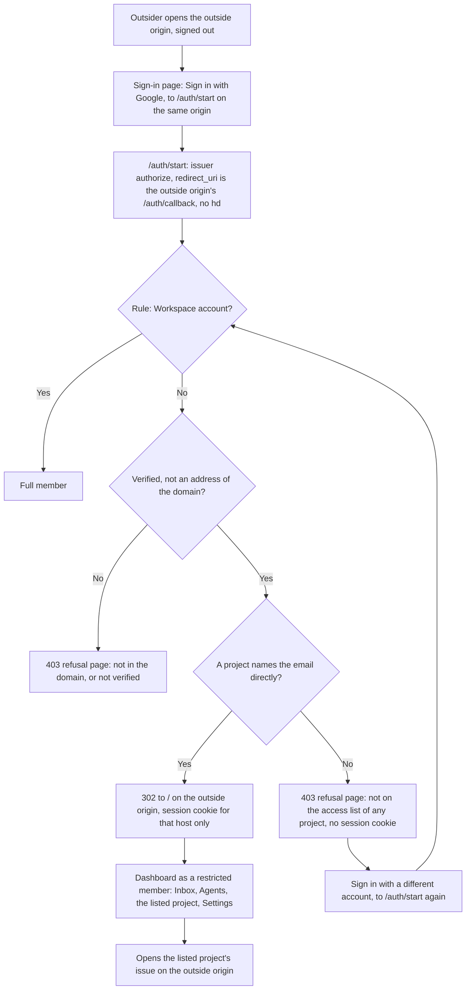
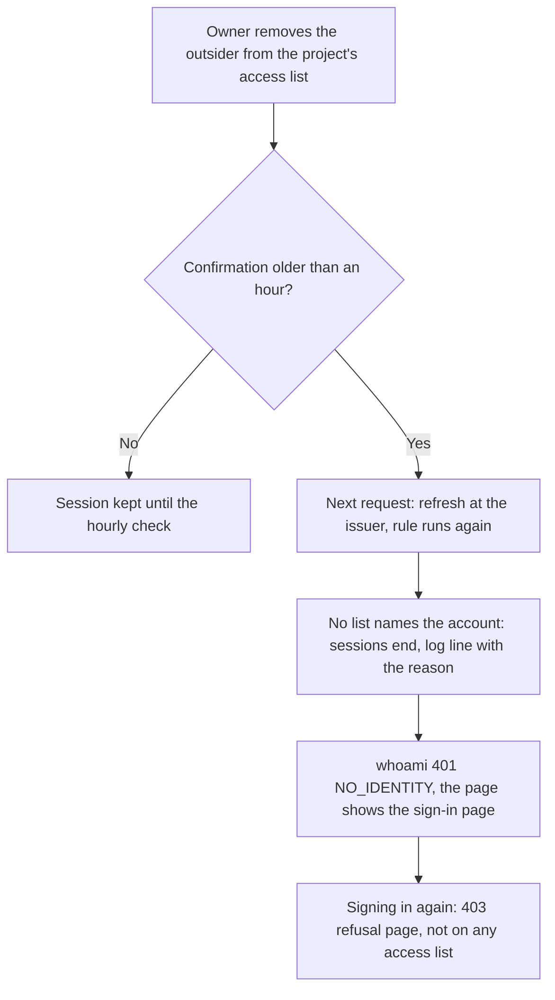
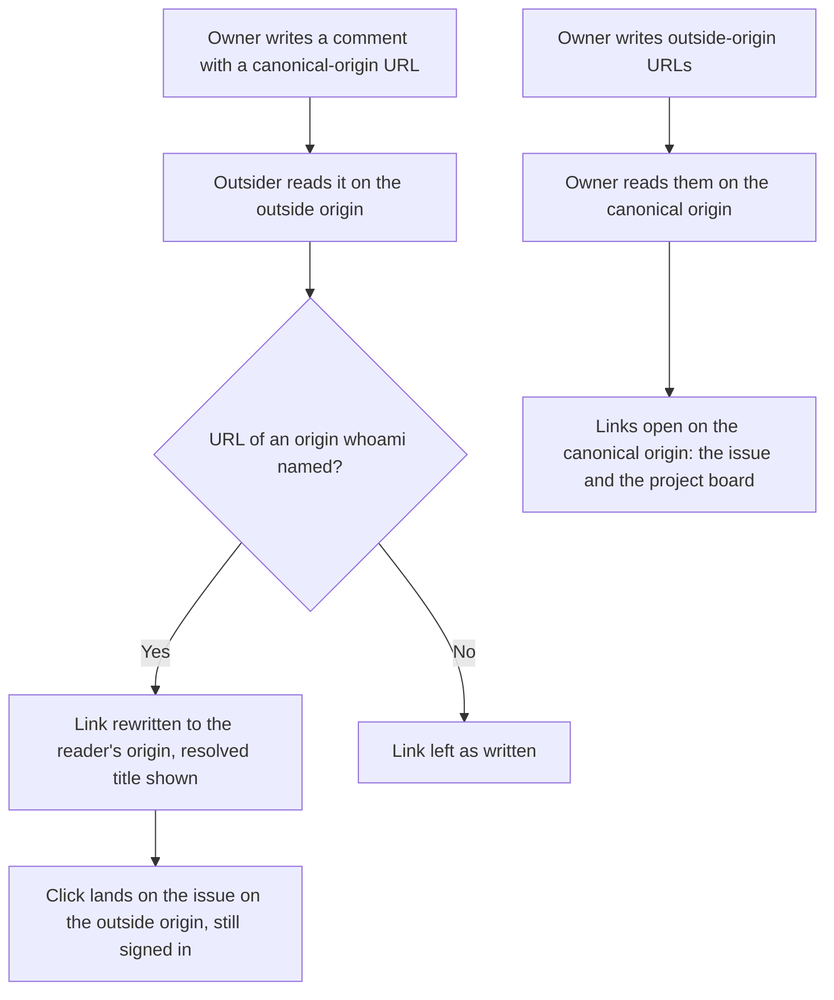
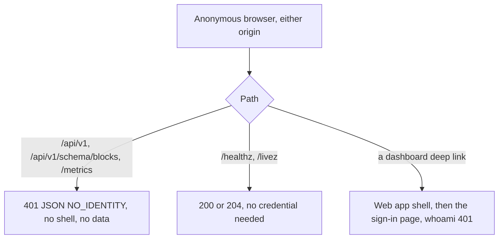

# Dogfood Report — outside sign-in (PR #4199)

> Diff-scoped browser QA of PR #4199 against its base branch, at `a7ab6a9eea`. Generated by `ce-dogfood` on 2026-11-16.
>
> After this run, the branch took decisions A, B and C, the first three under "Decisions for a Human": A, a delisted outsider is told why they were signed out (`2804f66051`); B, the refusal page's "Sign in with a different account" asks Google for its account chooser (`b03f2a768d`); C, `/metrics/` and the other variants of a server route answer a JSON 404 (`b03f2a768d`). The findings below are what the run saw.

Scope: the sign-in surface only. What a restricted member may read (avenue A's read rules) and the
rest of the dashboard are out of scope. The servers ran under the browser harness's
`DISPATCH_E2E_SIGNIN=google` mode (`bun e2e/harness-up.ts`), with the dev OIDC issuer standing in
for Google: canonical origin `http://127.0.0.1:<port>`, outside origin `http://localhost:<port>`,
Workspace domain `example.com`. Each person was queued at the issuer's `POST /_dev/sign-in-as` with
the claims Google gives that account. The browser was the `agent-browser` CLI, one isolated session
per person (owner, outsider, stranger, anonymous, phone).

## Diff Summary

- Outside sign-in: with `DISPATCH_SIGNIN_OUTSIDE=1` beside `DISPATCH_SIGNIN_DOMAIN`, a verified Google
  account outside the Workspace domain signs in as a restricted member while a project names its
  email directly (owner, or a person on the access list). Anyone else outside the domain gets a
  403 refusal page naming the address. The hourly confirmation runs the rule again and signs out an
  account no list names any more.
- A second origin, `DISPATCH_OUTSIDE_ORIGIN`: a request whose `Host` is its host is answered as that
  origin (its `/auth/callback`, the `Origin` its cookie writes must carry). `/auth/whoami` names
  both origins (`origins`). `/auth/start` names no `hd` to the issuer under outside sign-in.
- The web app reads a dashboard URL of either origin as a reference and opens it on the origin the
  reader is on (`packages/dispatch/web/src/api/origins.ts`, `features/refs/RefLink.tsx`,
  `features/refs/routes.ts`).
- Every route but sign-in, `/healthz`, `/livez` and the web app needs a credential: `GET /api/v1`,
  `GET /api/v1/schema/blocks` and the new route-table row `GET /metrics` answer 401 to a caller
  with none.
- The browser harness gains `DISPATCH_E2E_SIGNIN=google` and `packages/dispatch/e2e/outside-sign-in.e2e.ts`.

## Personas

- **Project owner** — a person taking themselves out of the terminal, who owns a product and decides
  who outside the company may work on one project — `STRATEGY.md`, Dispatch "Users".
- **Outside collaborator** — a person with a personal Google account whom one project's owner
  listed; wants to sign in once, land on their work and follow links colleagues send — inferred
  from the diff and `docs/site/src/content/docs/dispatch/running-dispatch.md`, "People from outside
  the domain".
- **Unlisted outsider** — someone outside the domain whom no project names; needs to understand why
  they are refused and what to do next — inferred from the refusal page's copy.
- **Operator** (secondary) — reads the server's log when a person reports being signed out —
  inferred.

No Compound Packs are declared (`packs-resolve.py`: no roots, no warnings, no errors).

## Flows Tested

## Test Matrix & Results

| # | Flow | Journey / Scenario | Status | Issue | Fix | Commit |
|---|------|--------------------|--------|-------|-----|--------|
| 1 | A owner | Workspace owner signs in at the canonical origin; whoami names both origins, no `member_kind` | Pass | - | - | - |
| 2 | B outside sign-in | Signed-out outside origin shows the sign-in page; its link stays on the outside origin | Pass | - | - | - |
| 3 | B outside sign-in | Listed outsider completes sign-in at the outside origin: callback 302 to `/` there, cookie on that host only | Pass | - | - | - |
| 4 | B outside sign-in | Dashboard as a restricted member right after sign-in | Fixed | Inbox said "Couldn't load credential requests." and the tab asked again 3 times every 15 s | The 403 `DEPLOYMENT_READ_REFUSED` is definitive and reads as no requests | 3f1c383a2d |
| 5 | B outside sign-in | Outsider opens the listed project's issue on the outside origin | Pass | - | - | - |
| 6 | B outside sign-in | The outsider's session is the outside origin's alone: the canonical origin shows sign-in | Pass | - | - | - |
| 7 | C refusal | Unlisted outsider is refused at the outside origin: 403 page naming the address, no session cookie | Pass | - | - | - |
| 8 | C refusal | "Sign in with a different account" on the refusal page leads back through sign-in and a listed account gets in | Pass | Real Google's chooser is row 18 | - | - |
| 9 | C refusal | Refusal page at phone width | Fixed | No viewport: a phone laid the page out 980 px wide and scaled it to a third | Viewport meta on the page | 8e7ae1d79b |
| 10 | D delisting | Owner delists the outsider; at the next hourly check the outsider's next page is sign-in, whoami 401 | Fixed | Browser behaviour correct; the log line said "Google did not confirm the person's membership of the domain" | OutsideRule.End logs its own words | 03168008b6 |
| 11 | D delisting | The delisted outsider signing in again is refused with the not-listed page | Pass | - | - | - |
| 12 | E links | A canonical-origin link in a comment opens on the outside origin for the outsider | Pass | - | - | - |
| 13 | E links | An outside-origin link in a comment opens on the canonical origin for the owner | Pass | - | - | - |
| 14 | F credential | Anonymous browser visit to `/api/v1` on both origins: 401 JSON, no shell, no data | Pass | - | - | - |
| 15 | F credential | Anonymous browser visit to `/api/v1/schema/blocks` on both origins: 401 JSON | Pass | - | - | - |
| 16 | F credential | Anonymous browser visit to `/metrics` on both origins: 401 JSON | Pass | `/metrics/` (trailing slash) is the shell: decision below | - | - |
| 17 | F credential | Adjacent: `/healthz` and `/livez` still answer anonymously; an anonymous deep link gets the sign-in page | Pass | - | - | - |
| 18 | C refusal | Real Google in the issuer's place: the chooser offers a personal account (no `hd`), and "Sign in with a different account" lets a person with one Google session pick another account | Blocked (needs human verify) | Needs a real Google client and accounts | - | - |

Status values: `Pending`, `Pass`, `Fixed`, `Skipped`, `Blocked (needs human verify)`, `Blocked (human decision)`.

What each row saw:

1. `/auth/whoami` answered `{"kind":"user","login":"alice@example.com","origins":["http://127.0.0.1:<port>","http://localhost:<port>"]}`, no `member_kind`. The dashboard showed "Signed in as alice@example.com".
2. The outside origin's `/` rendered "Make the next decision clear." and "Sign in with Google", whose href resolves to `http://localhost:<port>/auth/start`. `/auth/start` on each origin sent the issuer that origin's own `redirect_uri`, with `access_type=offline&prompt=consent` and no `hd`.
3. The browser went `/auth/start` -> issuer `/authorize` -> `localhost` `/auth/callback` -> `/` on the outside origin. One cookie, `dsession`, HttpOnly, SameSite Strict, domain `localhost`. whoami: `"member_kind":"restricted"` and both origins.
4. Before the fix: the rail showed Inbox, Agents, PROJECTS "PRIV Private work" and Settings, but the Inbox body held no empty state, and `GET /api/v1/credential-requests?approver=me` failed 403 three times on load and three more every 15 s. The server log carried those bursts from that one tab from 11:50:11Z for as long as it stayed open. After the fix: "Nothing needs you", one 403 on load and none in the next 35 s. The owner's tab still polls the list (3 reads with 200 in 17 s after a reload), so the change reaches the refusal alone.
5. `/issues/PRIV-1` on the outside origin showed the heading "The private plan" and its tabs.
6. The same browser at `http://127.0.0.1:<port>/issues/PRIV-1` showed the sign-in page; whoami there was 401 `NO_IDENTITY`, and 200 again back on the outside origin.
7. `/auth/callback` answered 403 with "Sign-in refused / stranger@other.example is not on the access list of any Dispatch project. Ask a project's owner to add this address, then sign in again." The browser held no cookie. The server logged `sign-in refused ... reason="...: no Dispatch project's access list names this account"`.
8. With the listed account queued, the refusal page's link went through `/auth/start` and the issuer and landed signed in on `/` of the outside origin, a restricted member.
9. Before the fix, an emulated iPhone 14 laid the page out at 980 CSS px (`innerWidth` 980). After it, 390 px, with the reason and the link in readable type.
10. Control first: right after the owner removed the outsider, whoami still answered 200 (the sign-in is kept until the hourly check). With `people.confirmed_at` aged two hours, the next page load showed the sign-in page, whoami 401 `NO_IDENTITY`, and `people.confirmed_at` was cleared. The log line was the domain rule's words before the fix and `sign-in ended: the hourly confirmation no longer admits the person ... reason="...: no Dispatch project's access list names this account"` after it (seen in the final suite run's server log).
11. Signing in again after the delisting gave the same 403 page as row 7, naming `outsider@other.example`.
12. The comment "The plan is at http://127.0.0.1:<port>/issues/PRIV-1 now." rendered for the outsider as the reference "PRIV-1 The private plan" with `href` resolving to `http://localhost:<port>/issues/PRIV-1`; clicking it landed there, signed in. Control: after a harness restart on a new port, links to the old port, an origin Dispatch no longer answers at, stayed as written, so the rewrite is origin-specific.
13. The owner, on the canonical origin, saw the outside-origin URLs of `PUB-1` and the `PRIV` board as `http://127.0.0.1:<port>/issues/PUB-1` and `.../projects/PRIV`; clicking each opened it on the canonical origin, signed in.
14-16. Each of the three paths, opened as a top-level page on each origin by a browser with no cookie, showed `{"code":"NO_IDENTITY","error":"unauthorized"}` with status 401 and `application/json`. Control: the shared agent token and the owner's cookie got 200 from all three (the route index 117 KB JSON, the block schema 2.3 KB JSON, the metrics in Prometheus text), so the probe would have seen a non-401. `HEAD /metrics` is 401 too, and a bad bearer is 401 `UNAUTHORIZED`.
17. `/healthz` 200 JSON and `/livez` 204 on both origins with no credential; `/api/v1/issues/PRIV-1` 401; an anonymous `/issues/PRIV-1` showed the web app's sign-in page, whose only API read was whoami, 401.

## Pack Compliance

None: the repository declares no Compound Packs.

## What Was Fixed

### A restricted member's Inbox said credential requests failed to load — `3f1c383a2d`
- **Symptom:** right after an outside collaborator signed in, the Inbox showed "Couldn't load credential requests." where its empty state belongs, and the tab asked the server for the list three times on load and three more every 15 seconds for as long as it stayed open.
- **Root cause:** the server refuses a restricted member the deployment's pending credential requests (`GET /api/v1/credential-requests` is a deployment read, 403 `DEPLOYMENT_READ_REFUSED`). The web app's shared retry policy retried that 403 as transient, the pending-list query kept its 15-second poll armed after a failure, and `useCredentialRequests` read the failure as a list that never loaded.
- **Fix:** `isDeploymentReadRefused` in `packages/dispatch/web/src/api/client.ts` makes that 403 definitive in `isRetryableQueryError`; `packages/dispatch/web/src/features/credentials/pending.ts` holds the refusal like a Dispatch with no broker (no fetch of its own, no poll) and reads it as no requests.
- **Regression test:** `packages/dispatch/web/src/features/inbox/Inbox.test.tsx` ("a credential list the server refuses a restricted member reads as none, not as a failure"), `packages/dispatch/web/src/features/credentials/pending.test.tsx` ("credentialPendingQuery neither polls nor refetches a list the server refused the viewer") and `packages/dispatch/web/src/__tests__/client.test.ts` ("a read of the whole deployment refused to a restricted member is definitive and not retried"). With the two source files put back to `a7ab6a9eea`, the first two fail (2 of 93 in those files); with the fix, 137 of 137 pass in the three files. The browser replay is row 4.

### The sign-in refusal page was unreadable on a phone — `8e7ae1d79b`
- **Symptom:** on an emulated iPhone 14 the refusal page was laid out 980 CSS px wide and scaled to about a third, so the reason and "Sign in with a different account" came out in tiny type. An unlisted outsider is the reader most likely to meet this page, often on a phone.
- **Root cause:** `writeSignInRefusedPage` in `packages/envoy/internal/dispatch/routes/router.go` wrote no viewport meta; the dashboard's `index.html` and the secrets broker's pages do.
- **Fix:** the page names `width=device-width, initial-scale=1`.
- **Regression test:** `TestDomainSignInRefusesWithItsReasonOnThePageAndInTheLog` in `packages/envoy/internal/dispatch/routes/router_test.go` now requires the viewport meta on every refusal reason. It fails with `router.go` at `a7ab6a9eea` and passes after; the whole `internal/dispatch/routes` package passes. The browser replay is row 9 (innerWidth 980 before, 390 after).

### A delisted outsider's sign-out was logged as a lost Workspace membership — `03168008b6`
- **Symptom:** when the hourly check signed out an account from outside the domain that no project lists any more, the server logged `sign-in ended: Google did not confirm the person's membership of the domain` beside the reason `no Dispatch project's access list names this account`. An operator would look for a Workspace membership this person never had.
- **Root cause:** `OutsideRule.End` delegated to `DomainRule.End`, whose log line names the domain.
- **Fix:** `packages/envoy/internal/dispatch/identity/domain_rule.go` moves the end path into `endSubject`, which takes the rule's own words; `DomainRule.End` keeps its line, and `OutsideRule.End` (`outside_rule.go`) logs `sign-in ended: the hourly confirmation no longer admits the person`, with the same reason. The behaviour (which rows end, `ErrNoIdentity`) is unchanged.
- **Regression test:** `TestOutsideSignInMembershipEndsWhenNoListNamesTheAccount` in `packages/envoy/internal/dispatch/identity/membership_test.go` now reads the log line. It fails against the two rule files at `a7ab6a9eea` (quoting the domain line) and passes after; the `internal/dispatch/identity` package and `cmd/dispatch`'s sign-in tests pass.

## Paper Cuts (by persona)

- **Outside collaborator** — the Inbox said credential requests failed to load — sharp — fixed `3f1c383a2d`.
- **Unlisted outsider** — the refusal page was a scaled-down desktop page on a phone — sharp — fixed `8e7ae1d79b`.
- **Outside collaborator** — once delisted, the next page is the plain sign-in page with no word of why the session ended; only pressing "Sign in with Google" shows the refusal page with the reason — medium — deferred, decision below; taken on this branch after the run, `2804f66051`.
- **Outside collaborator** — the sign-in page says "Sign in to review your team's open decisions."; a person from outside is reviewing a client's or a partner's decisions, not their team's — low — deferred (copy unchanged by this branch).
- **Unlisted outsider** — "Ask a project's owner to add this address" does not say who that is; the person usually knows who invited them, so this is acceptable — low — deferred.
- **Operator** — the sign-out log line named a Workspace membership — medium — fixed `03168008b6`.

## Console Errors

- No page errors or console errors in any session (`agent-browser errors` empty after every scenario).
- Failed requests seen: `GET /api/v1/credential-requests?approver=me` 403 for the restricted member, repeated every 15 s (resolved by `3f1c383a2d`: one request per page load). `GET /api/v1/issues/PUB-1/summary` 404, three times, when the outsider's comment view met a link to an issue no list gives them: the page leaves that link as plain text, as it should; the retried 404 is the existing retry policy for any unknown reference and belongs to avenue A's read rules, so it was not touched here.

## Human Verifications

- Row 18, pending a person: with a real Google client (consent screen audience External) at both
  origins' `/auth/callback`: (a) a personal Google account sees itself in the chooser, since no `hd`
  is sent; (b) on the refusal page, "Sign in with a different account" lets a browser that holds
  exactly one Google session pick another account. `/auth/start` sends `prompt=consent` alone, not
  `select_account`; whether Google then shows its chooser for a single session is
  `[INFERENCE]`, not observed. The dev issuer signs in whoever is queued and cannot show this.

## Decisions for a Human

### A delisted outsider is signed out with no reason shown
- **What's broken:** row 10 is correct as specified, but the outside collaborator lands on the generic sign-in page with no explanation; they learn why only by trying to sign in again.
- **Why escalated:** saying why needs the server to tell the page (a distinct 401 code, or a short-lived cookie) and new copy on the sign-in page: a product and API decision, not a small fix.
- **Options:** (A) leave it: the refusal page explains on the next try, one extra click; (B) whoami answers the request that ended the sign-in with a code such as `SIGNIN_ENDED` carrying the reason, and the sign-in page shows one line ("Your access to Dispatch ended: no project lists outsider@other.example any more").
- **Recommendation:** B, after this PR, if outside collaborators are expected to be delisted routinely; A is acceptable for the first release.

### "Sign in with a different account" may not offer a different account with real Google
- **What's broken:** not observed (row 18 is blocked on a person). `/auth/start` sends `prompt=consent`, and with one Google session in the browser Google may go straight to consent for that same account, which would bring the unlisted person back to the same refusal page.
- **Why escalated:** changes the parameters sent to Google for every sign-in; needs the human check above first.
- **Options:** (A) send `prompt=consent select_account` from the refusal page's link only (e.g. `/auth/start?select=1`), so the ordinary sign-in is unchanged; (B) send it on every sign-in, one extra click for everyone; (C) leave it.
- **Recommendation:** check row 18 first; if (b) fails, A.

### `/metrics/` with a trailing slash answers the web app shell with 200
- **What's broken:** `GET /metrics/` (and other near misses such as `/API/V1`) answers 200 `text/html`, the shell, to an anonymous caller. No data leaks, but a scraper or probe with a trailing slash reads 200 as healthy. `/api/v1/` answers JSON 404, because `/api/` is the API's prefix.
- **Why escalated:** which paths the static handler treats as API paths is a routing choice outside the three routes this branch names.
- **Options:** (A) treat `/metrics/...` like `/api/...` in `staticHandler` (JSON 404); (B) leave it.
- **Recommendation:** A, small, in a follow-up of this branch's owner's choosing.

### A lint warning the suite reports outside this branch
- **What's broken:** `bun run lint` reports one warning, `lint/complexity/useOptionalChain` at `packages/dispatch/web/src/features/settings/AgentTokensSection.tsx:96`, from a commit of 2026-11-08 on the base, not from this branch. Lint exits 0.
- **Why escalated:** unrelated to the sign-in surface; fixing it here adds an unrelated file to this PR.
- **Options:** (A) fix it on its own branch (`bunx biome check --write` on that file); (B) leave it.
- **Recommendation:** A.

## Learnings

- A 403 that means "this is not for you" (`DEPLOYMENT_READ_REFUSED`) is an answer, not a failure: a page every person loads must not retry or poll it, and must not show it as a load error. Any new deployment-wide read a restricted member can reach from the shell needs the same handling.
- The cross-origin link rewrite was checked with a control that can fail: after a harness restart, links to the old port stayed as written while links to the current origins were rewritten.
- A server-rendered page outside the SPA (the refusal page) does not inherit the SPA's viewport; check it on a phone.

### Pack candidates

- "A response code that means the viewer may not have this (403 with a code, 404 FEATURE_OFF) is definitive in the shared retry policy and is never polled" — no pack declared; route through `ce-compound` if a pack is added.
- "Every server-rendered HTML page carries a viewport meta" — no pack declared.

## Final Status

Ready to ship on the sign-in surface, with three fixes on top of `a7ab6a9eea` for the branch owner to take
(`3f1c383a2d`, `8e7ae1d79b`, `03168008b6`) and row 18 waiting on a person with a real Google client.
Every matrix row is Pass or Fixed except row 18 (Blocked, needs human verify). The branch has since
taken the three fixes, as the same patches `d6d0aa04d8`, `2cb525ec2e` and `d70d735a9d`, and decisions
A, B and C (the note under the header).

Automated suite, run once after the last fix, at `03168008b6`, from `packages/dispatch`:
`bun run typecheck && bun run lint && DISPATCH_E2E_SIGNIN=google bunx playwright test --config e2e/playwright.config.ts outside-sign-in`
exit 0: typecheck clean; lint clean with one warning outside this branch (decision above); the
Playwright row "a person an access list names signs in at the outside origin as a restricted
member, and is signed out once no list names them" passed (1 passed). Also run: the three changed
web test files (137 pass), `go test ./internal/dispatch/routes/` (ok), `./internal/dispatch/identity/`
(ok) and `./cmd/dispatch/ -run 'Outside|SignIn'` (ok).
