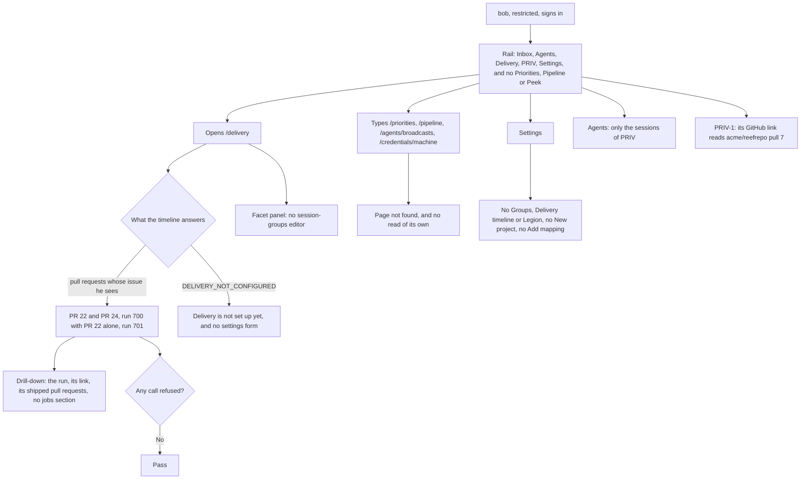
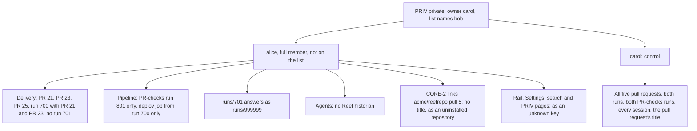
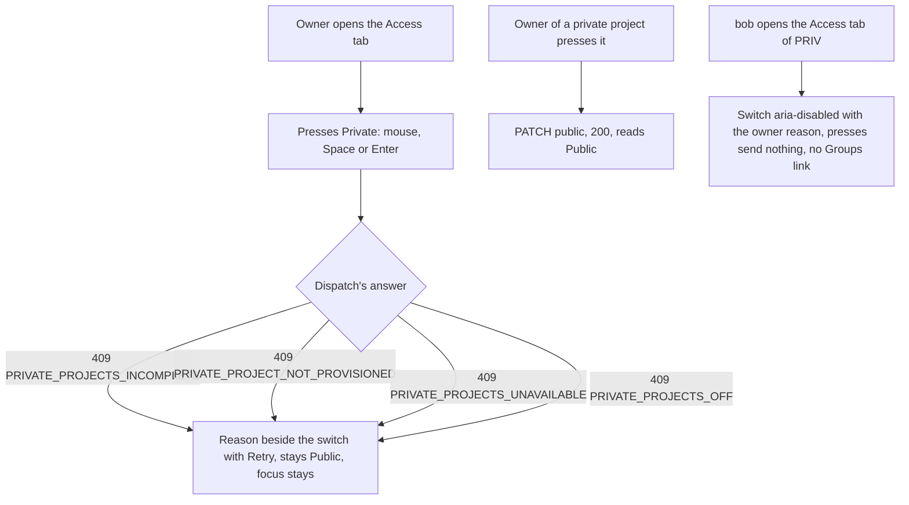
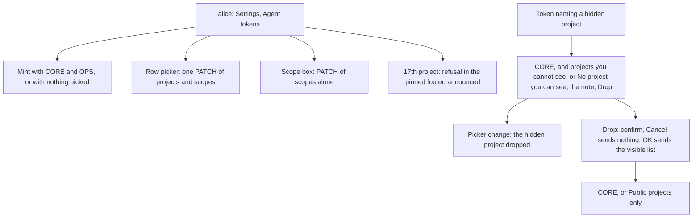
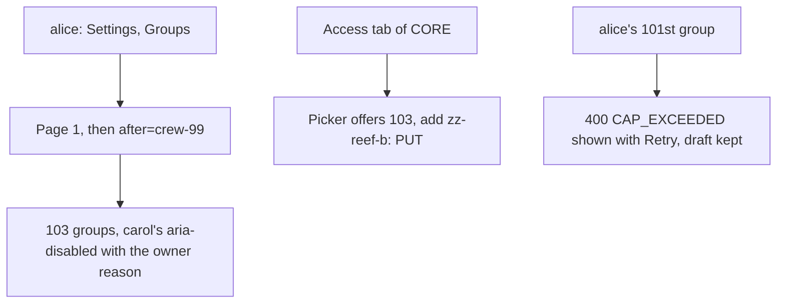

# Dogfood Report — INFRA-3862-private (slice A3, private projects), second run

> Diff-scoped browser QA of `INFRA-3862-private` at `01a76d5b92` vs its pull request base
> `origin/INFRA-3862-access` (`8294ae321a`); pull request #4177 is stacked on #4156. Generated by
> `ce-dogfood` on 2026-11-19. It resumes the first run at `6bdc68a75f`
> (`docs/dogfood-reports` of that run's workspace; 27 scenarios). Two fixes were committed on top:
> `6fdb6705d8` and `5c4aa07b44`.

## Diff Summary

The first run tested `6bdc68a75f`. Since then the branch took #4156 and `main` by merge, and these
commits of its own reach a page (read from `git log --first-parent 6bdc68a75f..01a76d5b92` and the
web diff):

- **Delivery** (`9975a4d993`, `3c16de8648`): the timeline, the measures, the Pipeline page and a
  run's drill-down show a pull request only to a reader who sees its issue; a run whose shipped
  pull requests are all hidden is left out; `GET /api/v1/delivery/runs/{id}` answers such a run as
  an unknown id. The timeline and the measures are now read class `project` alone, so a
  restricted member may read them; plan A's `t-a-21` (RM-D) gives that member the page, and the
  branch did not yet (rows 1, 15, 16).
- **Agents** (`9975a4d993`, `d950e4a423`): `GET /api/v1/agents` passes a session when the
  projects its listener names meet what the reader sees, or when `SessionClause` passes; no row
  carries `projects`.
- **GitHub proxy** (`c3652070fd`, `2a385d5591`): the dashboard's repository reads show a
  repository by the issues that resolve to it; a hidden one answers as one the App is not
  installed on.
- **Private switch** (`c83ff6554b`, `6fe6a5159d`): a project is made private only when
  `DISPATCH_PRIVATE_PROJECTS` names it, the store is complete and the hub takes its key; the
  Access tab shows each refusal's reason (`PRIVATE_PROJECTS_OFF`,
  `PRIVATE_PROJECT_NOT_PROVISIONED`, `PRIVATE_PROJECTS_INCOMPLETE`,
  `PRIVATE_PROJECTS_UNAVAILABLE`). The switch is now `aria-disabled`, never `disabled`, while its
  write is out.
- **Tokens** (`3824bd492c`, `0c9225c9fb`): a picker's refusal shows in its pinned footer as an
  alert; a token naming projects the reader cannot see has "Drop the projects you cannot see",
  which saves the visible list after a confirm.
- **Restricted member's Settings** (`c002ce2662`) draws no Legion section; the Access tab's
  Groups paragraph sends them to no Settings → Groups.

## Personas

- **Project owner / full member** — takes themselves out of the terminal, owns a product end to
  end and decides who sees it — `STRATEGY.md`, Dispatch "Users".
- **Restricted member** — a person from outside the company whom a project's access list names;
  reads only those projects and none of the deployment's own rows — inferred from the spec section
  the code cites (`dispatch://INFRA-3862/spec#b-r-cross-project-reads`) and plan A's `t-a-21`.
- **Full member left off a private project** — must not learn the project exists — inferred from
  the same spec.

No Compound Packs are declared (`packs-resolve.py`: no roots, no warnings, no errors).

## How the run was set up

- **The stack.** `bun run dispatch:local` from `packages/dispatch` (the e2e harness: the tree's
  Go server, fake Envoy, fake GitHub, fake secrets broker, dev sign-in), on a Postgres container
  of this run's own (pgvector on PostgreSQL 18, the image `scripts/dev-postgres.sh` pins). The
  server binary was built from the tree at `01a76d5b92` and started through a wrapper named in
  `DISPATCH_E2E_SERVER_BIN` that sets `DISPATCH_PRIVATE_PROJECTS=PRIV` (`run-server.sh` drops every
  `DISPATCH_*` variable it inherits), as `e2e/acceptance/project-access.sh` provisions PRIV. One
  `agent-browser` session each for alice, carol (`carol@example.com`) and bob
  (`bob@outside.example`).
- **The seed**, beyond `e2e/workspace.ts`, through the routes as each person: carol made PRIV
  ("Reef survey"), named bob on its list, filed PRIV-1 (its own repository `acme/reefrepo`, linked
  to `acme/reefrepo#7`) and wrote the document `reef-survey`; alice made P01-P15, linked CORE-2 to
  `acme/reefrepo#5` and CORE-3 to `acme/widgets#6`, minted `reef-only` (PRIV), `reef-and-core`,
  `reef-pick`, `reef-drop` (CORE, PRIV) and `core-ops` (CORE, OPS) while PRIV was public, and made
  100 groups; carol made 3. The fake Envoy got three more sessions: "Reef sampler" (its listener
  names PRIV), "Core builder" (names CORE) and "Reef historian" (no list). The fake GitHub got
  both repositories installed, with their pull requests, check runs and workflow runs.
- **Written by SQL**, as `e2e/delivery-seed.ts` and the acceptance drivers write them, because no
  route of this build writes them: bob's `member_kind = 'restricted'`; the delivery settings and,
  on 2026-11-17, pull requests #21 (CORE-1), #22 (PRIV-1), #23 (no issue), #24 (PRIV-1), #25
  (CORE-2, waiting), deploy runs 700 (shipped #21-#23), 701 (shipped #24 alone) and 702 (failed),
  and PR-checks runs 801 (#21) and 802 (#22); one `session_projects` row (Reef historian, PRIV);
  and PRIV private, after the switch was driven through all three refusals this deployment gives
  (rows 36-38): `update projects set visibility = 'private' where key = 'PRIV'`.
- The two store backfills ran with the tree's binary between rows 36 and 38:
  `backfill-session-projects` (169 events, 0 pairs) and `scrub-access-events` (169 events, 0
  rewritten).

## Flows Tested

## Test Matrix & Results

| # | Flow | Journey / Scenario | Status | Issue | Fix | Commit |
|---|------|--------------------|--------|-------|-----|--------|
| 1 | Restricted | bob's rail: Inbox, Agents, Delivery, PRIV, Settings; no Priorities, Pipeline or Peek (first run 1) | Fixed | at `01a76d5b92` the rail was `/`, `/agents`, `/projects/PRIV`, `/settings`: no Delivery | RM-D: rail and route | `5c4aa07b44` |
| 2 | Restricted | bob's Inbox: no credential-request line, no `credential-requests` read (first run 2) | Pass | - | - | - |
| 3 | Restricted | bob's `/priorities`, `/priorities/launch`, `/pipeline`, `/agents/broadcasts`, a broadcast, `/credentials/machine`: Page not found, no read of their own (first run 3) | Pass | - | - | - |
| 4 | Restricted | bob's Agents page: Machines, no Broadcasts; key `i` opens no drawer (first run 4) | Pass | - | - | - |
| 5 | Restricted | bob's Settings: no Groups, no Delivery timeline, no Legion; no Legion daemon read (first run 5, `c002ce2662`) | Pass | New project and Add mapping always refused (row 45) | - | - |
| 6 | Restricted | bob's PRIV-1: no priority line; search reads no new-issue settings (first run 6) | Pass | - | - | - |
| 7 | Restricted | bob's pages draw no refusal; control fetch of the priorities is refused (first run 7) | Pass | - | - | - |
| 8 | Restricted | bob's `/projects/CORE`, its Access tab and `/issues/CORE-1` read as missing (first run 8) | Pass | - | - | - |
| 9 | Restricted | bob at 390 px: no Peek in the header; the menu's rail matches (first run 9) | Pass | after `5c4aa07b44` the menu's rail is `/`, `/agents`, `/delivery`, `/projects/PRIV`, `/settings`; page 390 px wide; alice's header has Peek (control) | - | - |
| 10 | Restricted | bob's PRIV Access tab: no Settings → Groups link; switch on, `aria-disabled`, owner reason; presses send nothing (first run 23) | Pass | - | - | - |
| 11 | Delivery | alice's timeline shows only the pull requests whose issue she sees, and no run that shipped only hidden ones; carol's shows all (control) | Pass | - | - | - |
| 12 | Delivery | alice's run drill-down lists only shown pull requests; a hidden run's id answers as missing | Pass | - | - | - |
| 13 | Delivery | alice's measures count only shown pull requests (carol's: control) | Pass | - | - | - |
| 14 | Delivery | alice's Pipeline page: the PR-checks run of a hidden pull request and a hidden deploy run left out (carol's: control) | Pass | - | - | - |
| 15 | Delivery | bob's `/delivery`: his pull requests only, no jobs section, no session-groups editor, no refused call | Fixed | at `01a76d5b92`: Page not found, though the server answers him the timeline (`prs=22,24`); after: PR 22 and PR 24, 2 deploys, run 700 lists PR 22 alone, no Jobs, no Edit groups, 5 API answers all 2xx, no deployment-class read | RM-D | `5c4aa07b44` |
| 16 | Delivery | bob's `/delivery` with no delivery settings: "Delivery is not set up yet.", no settings form, no refused call | Fixed | after: "Delivery is not set up yet.", no form, no `settings/delivery` read; alice's same page shows "Set up the delivery timeline" and the form (control) | RM-D | `5c4aa07b44` |
| 17 | Agents | bob's Agents page lists only the sessions of PRIV (listed or with history) | Pass | - | - | - |
| 18 | Agents | alice's Agents page leaves out the session with PRIV history; carol's lists every session (control) | Pass | - | - | - |
| 19 | Agents | no row of the agents answer carries `projects` | Pass | - | - | - |
| 20 | GitHub | alice's link to a repository only PRIV-1 resolves to reads no title; a public repository's does; carol's reads both | Pass | - | - | - |
| 21 | GitHub | bob's PRIV-1 link reads its pull request's title | Pass | - | - | - |
| 22 | Private unseen | alice's rail: no PRIV (first run 10) | Pass | - | - | - |
| 23 | Private unseen | alice's Settings → Projects and project bar: no PRIV (first run 11) | Pass | - | - | - |
| 24 | Private unseen | alice's search for "reef" and "PRIV-1": no results; carol's finds them (first run 12) | Pass | - | - | - |
| 25 | Private unseen | alice's PRIV-1, PRIV, its Access tab, Documents and `reef-survey` read as an unknown key's (first run 13) | Pass | - | - | - |
| 26 | Private unseen | carol's rail lists PRIV; PRIV-1 opens; her switch is on, Private, enabled (first run 14) | Pass | - | - | - |
| 27 | Tokens | mint naming CORE and OPS (first run 15) | Pass | - | - | - |
| 28 | Tokens | mint with the picker untouched: no `projects`, "Public projects only" (first run 16) | Pass | - | - | - |
| 29 | Tokens | change a token's projects: one PATCH of projects and scopes (first run 17) | Pass | - | - | - |
| 30 | Tokens | a scope box: PATCH of scopes alone (first run 18) | Pass | - | - | - |
| 31 | Tokens | a 17th project: the refusal in the pinned footer, announced (first run 19) | Pass | - | - | - |
| 32 | Tokens | tokens naming hidden projects: "No project you can see" / "CORE, and projects you cannot see", the note and Drop (first run 20) | Pass | - | - | - |
| 33 | Tokens | a picker change on a token naming a hidden project drops it (first run 21, first half) | Pass | - | - | - |
| 34 | Tokens | Drop on `reef-and-core`: the confirm's words, PATCH `[CORE]`; Cancel sends nothing | Pass | - | - | - |
| 35 | Tokens | Drop on `reef-only`: PATCH `[]`, "Public projects only" (the first run's decision) | Pass | - | - | - |
| 36 | Access | carol's public PRIV: Private refused `PRIVATE_PROJECTS_INCOMPLETE`, reason and Retry; keyboard keeps focus | Pass | - | - | - |
| 37 | Access | alice's CORE: Private refused `PRIVATE_PROJECT_NOT_PROVISIONED` | Pass | - | - | - |
| 38 | Access | carol's PRIV once the store is complete: Private refused `PRIVATE_PROJECTS_UNAVAILABLE` | Pass | - | - | - |
| 39 | Access | a deployment naming no private project: Private refused `PRIVATE_PROJECTS_OFF` (first run 22) | Pass | second stack, list empty; Space and Retry each send the PATCH; reason and Retry shown; focus stays | - | - |
| 40 | Access | carol's private PRIV: the switch to public is taken | Pass | Space: `PATCH {visibility: public}` 200, reads Public, focus stays; alice then opens PRIV | - | - |
| 41 | Groups | Settings → Groups reads both pages, 103 groups (first run 24) | Pass | - | - | - |
| 42 | Groups | the Access tab's group picker offers page 2's groups (first run 25) | Pass | - | - | - |
| 43 | Groups | a 101st group: `CAP_EXCEEDED` shown with Retry (first run 26) | Pass | - | - | - |
| 44 | Events | the access-change event descriptions name no person or group (first run 27) | Skipped | still no page shows a project-level event | - | - |
| 45 | Restricted | bob's Settings offers no write Dispatch always refuses him (New project, Add mapping) | Fixed | both answered `403 RESTRICTED_MEMBER` with Retry; after: neither form drawn for bob, both for alice (control) | Forms left out for a restricted member | `6fdb6705d8` |

Status values: `Pending`, `Pass`, `Fixed`, `Skipped`, `Blocked (needs human verify)`, `Blocked (human decision)`.

## Pack Compliance

None: the repository declares no Compound Packs (`packs-resolve.py`: no roots, no warnings, no
errors).

## What Was Fixed

### A restricted member could not reach Delivery — `5c4aa07b44`
- **Symptom:** bob's rail had no Delivery and `/delivery` read "Page not found", though the server
  answers him the timeline and measures of the pull requests whose issue he sees
  (`GET /api/v1/delivery/timeline` 200, `prs=22,24`); the drill-down's jobs, the Pipeline page and
  the delivery settings answer him `403 DEPLOYMENT_READ_REFUSED`.
- **Root cause:** `9975a4d993` made the timeline and the measures read class `project`, and plan A's
  `t-a-21` (RM-D) gives a restricted member Delivery, but the web still held `/delivery` in
  `DeploymentPages` and hid the rail row.
- **Fix:** built as `a3-reports/integrator-runs/plan-a-live.md:2097-2160` writes it (line 2121, and
  2123-2157), on the integrator's direction: `/delivery` leaves `DeploymentPages`; the rail draws
  Delivery for a restricted member, still no Priorities, Pipeline or Peek; for that member the page
  mounts no `RunJobs`, draws no session-groups editor, and says "Delivery is not set up yet." in
  place of the settings form; for any viewer, `RunJobs` and `DeliverySettingsForm` draw nothing on
  `403 DEPLOYMENT_READ_REFUSED` (`isDeploymentReadRefused` in `web/src/api/client.ts`). Docs and the
  changelog fragment that named Delivery a deployment read were corrected.
- **Regression tests**, each red before and green after: `Sidebar.test.tsx` (9/9),
  `app.test.tsx` (16/16), `DeliveryPage.test.tsx` (21/21), `DrillDown.test.tsx` two rows (4/4),
  `FacetPanel.test.tsx` (4/4), `DeliverySettingsForm.test.tsx` (8/8), `restricted-member.e2e.ts`
  rail row and a new row "a restricted member reads Delivery for the pull requests of the projects
  that name them" (3 passed), `restricted-member.stub.e2e.ts` rail row (recorded and replayed).
  Controls, each failing alone: Delivery hidden again fails the rail row on `/delivery`; `RunJobs`
  mounted for bob fails the new row on `GET /api/v1/delivery/runs/700 DEPLOYMENT_READ_REFUSED`; the
  403 treated as any error fails the refused-jobs row. Browser replay: rows 1, 9, 15, 16.

### A restricted member's Settings offered writes Dispatch always refuses — `6fdb6705d8`
- **Symptom:** bob's Settings drew the New project form, the Add mapping form and, on a listed
  mapping, its Default radio and Delete. Pressing New project (BOBX) and Add mapping
  (`acme/bobrepo` → PRIV) each ended in a red line naming a route — "a restricted member cannot
  write POST /api/v1/projects, which belongs to the deployment rather than to a project" — with a
  Retry that can only repeat it (`403 RESTRICTED_MEMBER` both times).
- **Root cause:** `c1cf206e25` left the deployment's refusal as the one gate on those writes, and
  the two sections drew their forms for every reader, while the slice's other deployment-only
  sections (Groups, Delivery timeline, Legion) are left out for a restricted member.
- **Fix:** `packages/dispatch/web/src/features/settings/ProjectsSection.tsx` draws no create form
  for a restricted member; `packages/dispatch/web/src/features/settings/SettingsPage.tsx` draws no
  Add mapping form and no mapping Default or Delete control for them, and says "Default" in words
  on the default mapping. A full member's page is unchanged.
- **Regression test:** `web/src/features/settings/SettingsPage.test.tsx`, "a restricted member's
  Settings offers no project or mapping write, which Dispatch refuses them": red before the fix
  (all four controls drawn for bob: `addMapping`, `deleteMapping`, `mappingDefault`, `newProject`
  each `true`), green after; its full-member half holds all four drawn. `SettingsPage.test.tsx`,
  `ProjectsSection.test.tsx` and `__tests__/settings.test.tsx`: 23 pass, 0 fail.

## Paper Cuts (by persona)

- **Restricted member** — New project and Add mapping offered and always refused — sharp — fixed
  `6fdb6705d8`.
- **Project owner** — every refusal of the Private switch is operator text: "session_projects_filled
  holds no row … run envoy-dispatch backfill-session-projects", "CORE is not one of the projects
  DISPATCH_PRIVATE_PROJECTS names … (the infrastructure repository's privateprojects.Projects())",
  "the hub's envoy_private_projects bucket … this deployment has no bus to write it to"; an owner
  can act on none of them, and Retry beside each repeats the same answer — medium — escalated
  (Decisions).
- **Full member** — a run's drill-down gives job times in seconds ("success (1500s)") — low —
  not this branch's: `DrillDown.tsx`'s job line is `main`'s; named here, not fixed.

## Console Errors

None from the dashboard. `agent-browser console` and `errors` held nothing for alice, carol or
bob. Controls, run in carol's session: a `console.error('dogfood2-control-console')` from the page
was captured, and a thrown `Error('dogfood2-control-thrown')` showed in `errors --json` (the plain
`errors` printed `✗` with no text, as on the first run). Every non-2xx answer in the request
records was one a row asked for: the 409s of rows 36-38, the 403 `RESTRICTED_MEMBER`s of row 45,
the 400 `CAP_EXCEEDED` of row 43, the 404s of hidden or unknown keys (rows 8, 12, 25), the 503
`GITHUB_TOKEN_UNAVAILABLE` of row 20 and row 7's control 403.

## Human Verifications

Not applicable: dev sign-in, no outside interaction.

## Decisions for a Human

### The Private switch's refusals speak to an operator, not to the owner who pressed it
- **What's broken:** rows 36-38 pass (the switch stays Public, the reason shows beside it as an
  alert, focus stays), but each reason is Dispatch's operator sentence verbatim: a table name, an
  `envoy-dispatch` command, an environment variable, an infrastructure function, a NATS bucket.
  Retry is offered beside answers a retry cannot change.
- **Why escalated:** what an owner reads is product copy, the slice chose to show Dispatch's own
  reason (`6fe6a5159d`, "the switch shows Dispatch's own reason beside it"), and the words live in
  the Go server's error bodies.
- **Options:** (a) keep it: one sentence for operators and owners alike; (b) the dashboard maps the
  four codes to an owner's sentence ("This deployment cannot make CORE private yet. Ask its
  operator.") and offers Retry only where a retry can help (`PRIVATE_PROJECTS_UNAVAILABLE`), the
  server's text kept in a detail; (c) the server answers an owner's sentence and keeps the
  operator's in its log.
- **Recommendation:** (b): small, in the slice's web code, and it leaves the server's words for
  the operator who reads the log.

### A session whose listener names only a project the reader cannot see, and that has no history, is listed to every open viewer
- **What's broken:** alice's Agents page lists "Reef sampler", whose listener names PRIV alone and
  which has written nothing yet, beside "Core builder" (CORE) and the workspace sessions; it leaves
  out "Reef historian", which has a `session_projects` row in PRIV (row 18). bob sees only Reef
  sampler and Reef historian (row 17). The code does what its comment says
  (`api/agents.go:64-70`, `visibleRosterSessions`): the list passes a row only when it meets what
  the reader sees, and otherwise `SessionClause` decides, whose open arm passes any session with no
  history in a hidden project. Plan A's ledger reads otherwise: row L12r5
  (`a3-reports/integrator-runs/plan-a-live.md:3157`) says "A session with no pair is judged by its
  listener record's `projects`", while the task text (`plan-a-live.md:1335`) says a row passes when
  its list meets `sees` or `SessionClause` passes.
- **Why escalated:** which rule holds is the spec's call (R4 against K6), and the change is the
  server's read rule, not a page.
- **Options:** (a) keep it: a session is placed in a project only by what it did; (b) a session
  with no history whose listener names projects passes an open viewer only when one of them is a
  project the viewer sees (L12r5's sentence); (c) as (b), and also for a session with history.
- **Recommendation:** (b), if L12r5 is the plan's current rule: the listener's list is the one
  fact about such a session, and today it is read only to admit.

## Learnings

- The GitHub proxy forwards a commit's check runs only for a sha of 7 to 64 hex characters
  (`githubapi/proxy.go`'s `readable`). A fake GitHub seeded with short shas makes the proxy answer
  `404 GITHUB_PATH_REFUSED`, which reads like a proxy bug: seed 40-character shas.
- `run-server.sh` drops every `DISPATCH_*` variable it inherits, so a browser run that needs a
  server setting (here `DISPATCH_PRIVATE_PROJECTS`) names a wrapper script in
  `DISPATCH_E2E_SERVER_BIN` that sets it and execs the built binary.
- With `DISPATCH_PRIVATE_PROJECTS` naming a project, the switch walks through
  `PRIVATE_PROJECTS_INCOMPLETE` until `envoy-dispatch backfill-session-projects` and
  `scrub-access-events` have run, then `PRIVATE_PROJECTS_UNAVAILABLE` (this build has no hub
  writer): no build of this branch makes a project private through the route.
- In a MultiSelect, a selected option's text starts with "✓", so a test that finds an option by
  `textContent.startsWith(key)` misses the ticked ones.

### Pack candidates

- A control a reader's member kind always refuses is not drawn for that reader (no pack declared;
  would refine an access or UI pack).
- A refusal's sentence is written for the person who pressed, and Retry is offered only where a
  retry can change the answer (no pack declared).

## Final Status

Ready, with two decisions open. Of 45 scenarios: 40 Pass, 4 Fixed (rows 1, 15 and 16 by
`5c4aa07b44`, row 45 by `6fdb6705d8`; rows 5 and 9 were re-run after them and pass), 1 Skipped
(row 44: no page shows a project-level event). No scenario is Blocked; the two decisions above
concern rows that pass functionally (36-38: the refusal's words; 17-18: the agents-list rule).
The read rule held on every page driven: alice's Delivery, Pipeline, drill-down, Agents page and
GitHub link each left out exactly what PRIV holds, and bob read Delivery for PRIV's pull requests
with no call refused.

Two observations that are not defects of this branch, for the integrator: a failed deploy run
that shipped nothing (run 702, which carried only CORE's waiting PR 25) is shown to bob, as the
rule "a run that shipped pull requests none of which is shown is left out" reads; and the helper
that built RM-D logged that a `403 DEPLOYMENT_READ_REFUSED` is still retried twice by the shared
query retry policy (`isRetryableQueryError`), so a section whose read is refused shows "Loading…"
through two retries before it disappears. Changing that policy changes retries app-wide.

The dispatch web lane ran once at the end, at `5c4aa07b44` with this report uncommitted, from
`packages/dispatch` (20:53:46Z to 20:56:35Z): `bun run typecheck` exit 0; `bun run lint` exit 0;
`bun run test` exit 0: web 5333 pass, 0 fail, 297 files; `e2e/__tests__` 761 pass, 13 skip, 0
fail, 49 files (the 13 skipped need a Postgres variable this run did not set).

Neither fix is pushed: pull request #4177's head does not carry them until they are picked onto
`INFRA-3862-private`.
