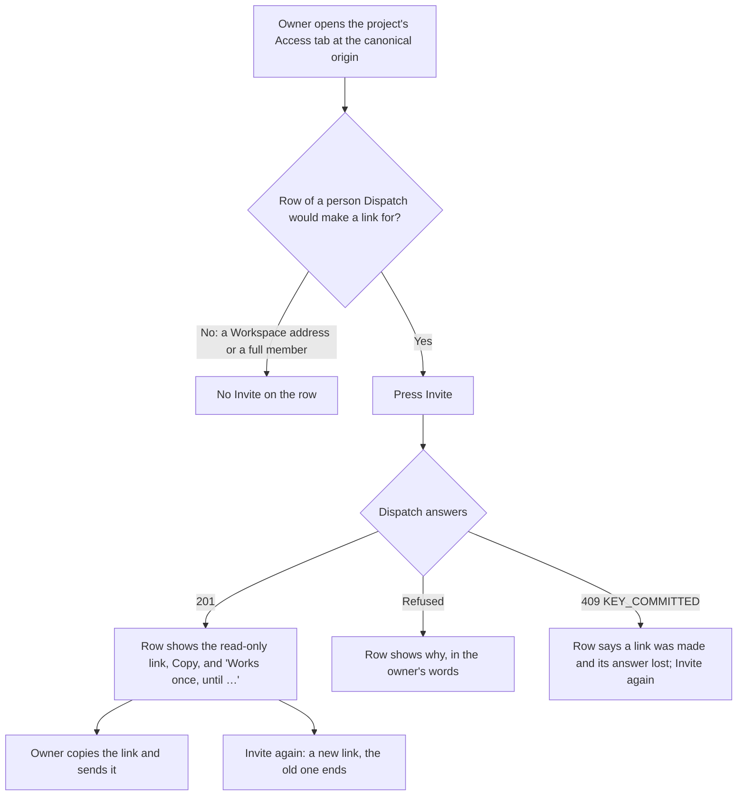
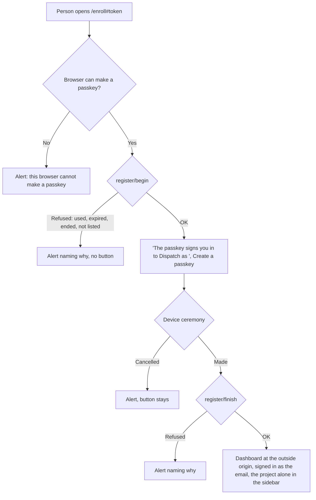
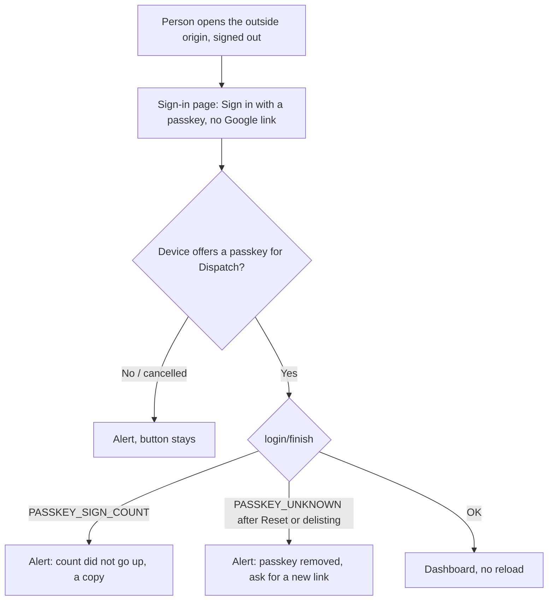
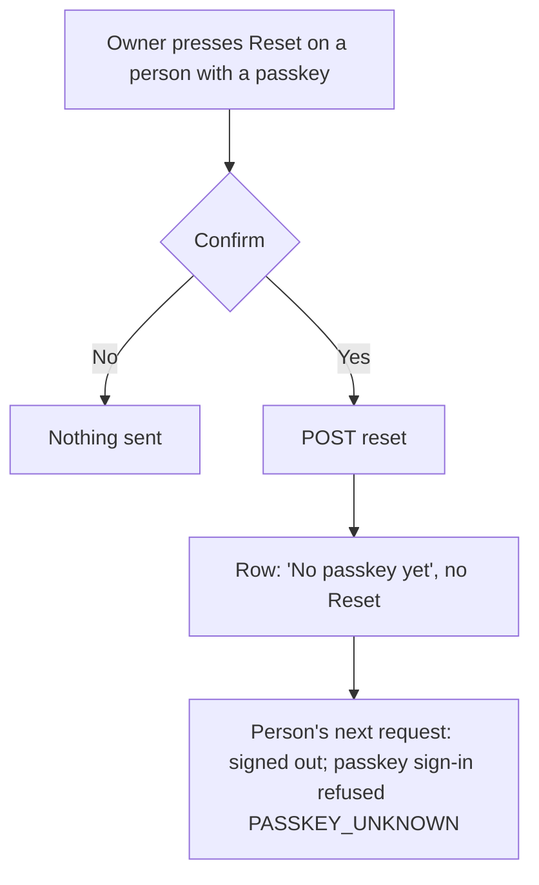

# Dogfood Report — legion/INFRA-3862-passkeys-web

> Diff-scoped browser QA of `legion/INFRA-3862-passkeys-web` against its base branch, `legion/INFRA-3862-passkeys` (the passkey routes). Generated by `ce-dogfood` on 2026-11-20.

Checkpoint: the matrix below is the plan, every scenario `Pending`. The run needs the base branch's routes, which were not on the remote when this checkpoint was written.

Scope: the passkey pages and the Access tab's person row. What a restricted member may read is avenue A's check and out of scope. The servers run under the browser harness's `DISPATCH_E2E_SIGNIN=google` mode (`bun e2e/harness-up.ts`): canonical origin `http://127.0.0.1:<port>`, where the dev OIDC issuer stands in for Google for the Workspace domain `example.com`, and outside origin `http://localhost:<port>`, where passkey sign-in is on (`DISPATCH_SIGNIN_PASSKEY=1`). The browser is the `agent-browser` CLI, one session per person. The person's device is Chromium's virtual authenticator, added to that session's page through its CDP endpoint (`agent-browser get cdp-url`) by a script that holds the CDP session open for the run, since Chromium removes a virtual authenticator when the session that added it detaches.

## Diff Summary

- `/enroll#<token>` (`web/src/features/signin/Enroll.tsx`): the page the owner's link opens, outside the sign-in gate. It checks the link, names the address it was made for, and its one button makes the passkey and signs the person in. A refused link says why and offers nothing to press.
- The outside origin's sign-in page (`web/src/features/signin/PasskeySignIn.tsx`, `web/src/app.tsx`): where whoami's 401 says `sign_in: "passkey"`, the page offers "Sign in with a passkey" in place of the Google link.
- The Access tab's person row (`web/src/features/project/AccessPersonRow.tsx`): for the owner, with passkeys on, each passkey's enrollment time or "No passkey yet", Invite where Dispatch would make a link (the read-only link, Copy, and when it stops), and Reset after a confirm.
- The client (`web/src/api/client.ts`) and contracts (`packages/contracts/src/dispatch-api-user.ts`): the invitation and Reset routes, the four ceremony steps, and the refusal codes.
- The browser harness's google mode turns passkey sign-in on, and `e2e/outside-passkey.e2e.ts` replaces `e2e/outside-sign-in.e2e.ts`.

## Personas

- **Project owner** — decides who outside the company works on one project, makes the link and sends it by a channel of their own — `STRATEGY.md`, Dispatch "Users".
- **Outside collaborator** — has no account of ours or Google's, opens the link once on their own device, then signs in with the passkey alone — inferred from the diff and the requirement it serves.
- **Holder of a dead link** — opened a link that was used, expired, or ended by the owner; needs to know what to ask for — inferred.

No Compound Packs are declared (`packs-resolve.py`: no roots, no warnings, no errors).

## Flows Tested

## Test Matrix & Results

| # | Flow | Journey / Scenario | Status | Issue | Fix | Commit |
|---|------|--------------------|--------|-------|-----|--------|
| 1 | Invite | Owner's Access tab: an outside person's row shows Invite; a Workspace colleague's row shows none | Pending | | | |
| 2 | Invite | Press Invite: the link, Copy and the expiry show in the row; the link is the outside origin's `/enroll#` | Pending | | | |
| 3 | Invite | Invite again: a new link replaces the shown one; the first link answers as ended | Pending | | | |
| 4 | Invite | A long email and a long link at phone width: no clipped text, the field scrolls | Pending | | | |
| 5 | Invite | Not the owner: no Invite, no Reset, no passkey lines | Pending | | | |
| 6 | Enroll | Valid link: the page names the address; Create a passkey enrolls and lands on the dashboard with the project alone | Pending | | | |
| 7 | Enroll | Used link: alert, no button | Pending | | | |
| 8 | Enroll | Expired link: alert, no button | Pending | | | |
| 9 | Enroll | Link ended by a delisting, a Reset or a newer link: alert, no button | Pending | | | |
| 10 | Enroll | `/enroll` with no fragment: alert, nothing asked of Dispatch | Pending | | | |
| 11 | Enroll | The device ceremony cancelled: alert, the button stays and a second press enrolls | Pending | | | |
| 12 | Sign-in | Signed out at the outside origin: Sign in with a passkey, no Google link; the canonical origin still shows Google | Pending | | | |
| 13 | Sign-in | Passkey sign-in lands on the dashboard without a reload | Pending | | | |
| 14 | Sign-in | A lowered sign count is refused on the page, the button stays | Pending | | | |
| 15 | Reset | Reset asks first; after it the row shows "No passkey yet" and the person's passkey signs in no more | Pending | | | |
| 16 | Access row | Passkey enrollment time: exact time and relative age, light and dark | Pending | | | |
| 17 | All | Keyboard: each button reachable and pressable with Enter; focus not lost while busy | Pending | | | |
| 18 | All | Console errors on each page | Pending | | | |

## Pack Compliance

None: the repository declares no packs.

## What Was Fixed

Nothing yet.

## Paper Cuts (by persona)

Not yet walked.

## Console Errors

Not yet read.

## Human Verifications

Not applicable: the passkey ceremony is driven on Chromium's virtual authenticator, and no step leaves the browser.

## Decisions for a Human

None yet.

## Learnings

None yet.

### Pack candidates

None.

## Final Status

Not ready: the run has not started. It needs the base branch's passkey routes.
