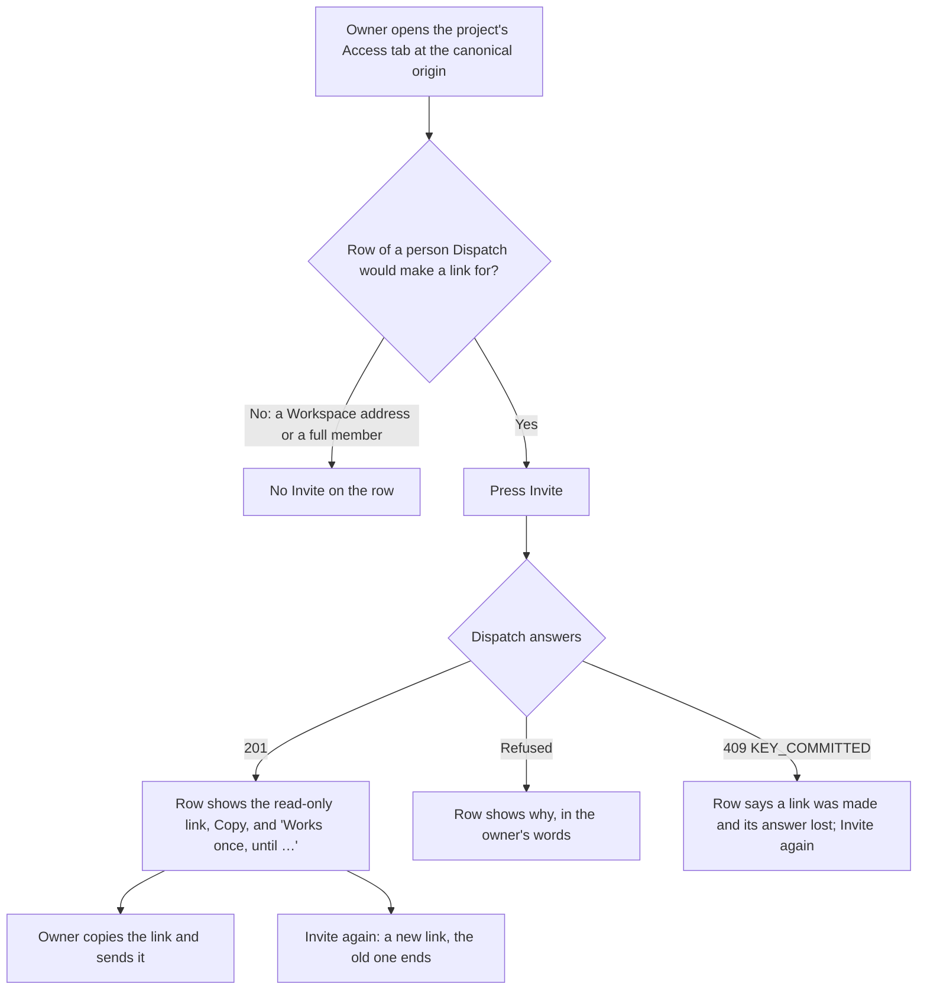
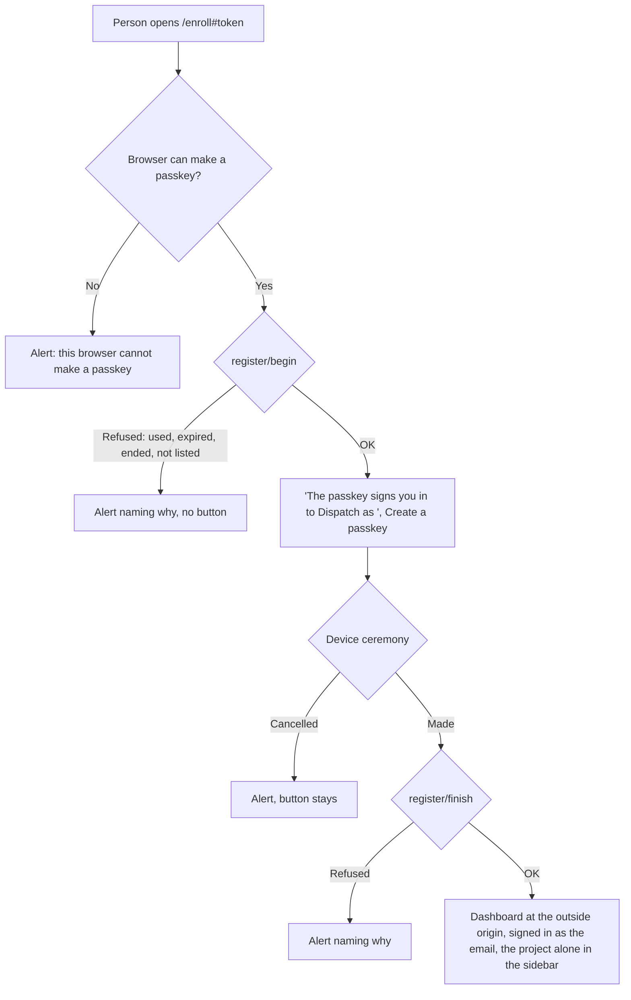
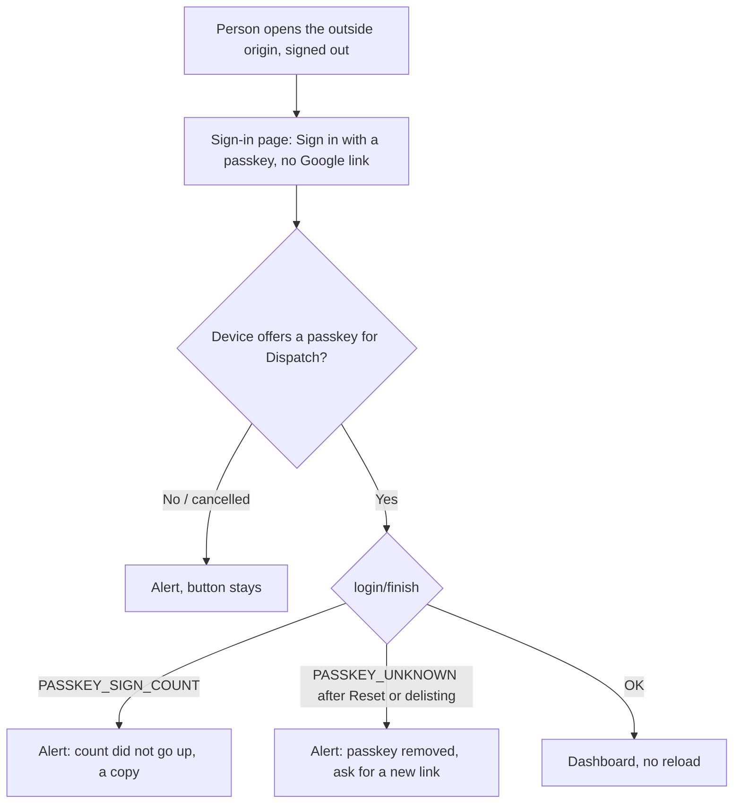
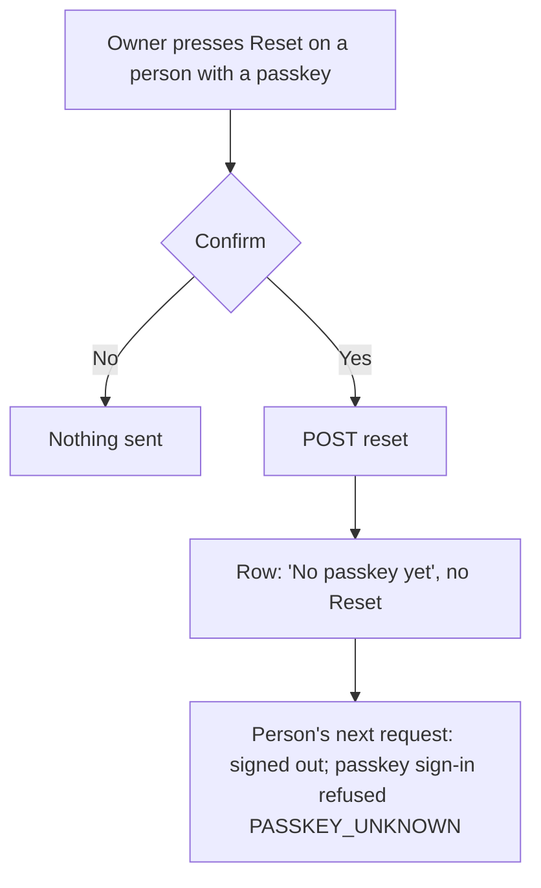

# Dogfood Report — the passkey pages

> Diff-scoped browser QA of the passkey pages' branch against its base branch, the passkey routes' branch (head `221aabb0d4`). Generated by `ce-dogfood` on 2026-11-20; the run started after 23:02:40Z and ended by 23:26:01Z (`date -u` before the stack started and after the screenshots were copied).

Scope: the passkey pages and the Access tab's person row. What a restricted member may read is avenue A's check and out of scope. The servers ran under the browser harness's `DISPATCH_E2E_SIGNIN=google` mode (`bun e2e/harness-up.ts`):
- the canonical origin `http://127.0.0.1:<port>`, where the dev OIDC issuer stands in for Google for the Workspace domain `example.com`;
- the outside origin `http://localhost:<port>`, where passkey sign-in is on (`DISPATCH_SIGNIN_PASSKEY=1`).

The browser was the `agent-browser` CLI, one session per person: the owner (`alice@example.com`), the outside person (`outsider@other.example`) and a stranger with no session. The outside person's device was Chromium's virtual authenticator. A scratch script added it to that session's page through the session's CDP endpoint (`agent-browser get cdp-url`) and held the CDP session open for the run, since Chromium removes a virtual authenticator when the session that added it detaches. The script was checked first on a localhost test page: with no authenticator the page made no passkey; with it, a passkey was made and then used.

## Diff Summary

- `/enroll#<token>` (`web/src/features/signin/Enroll.tsx`): the page the owner's link opens, outside the sign-in gate. It checks the link, names the address it was made for, and its one button makes the passkey and signs the person in. A refused link says why and offers nothing to press.
- The outside origin's sign-in page (`web/src/features/signin/PasskeySignIn.tsx`, `web/src/app.tsx`): where whoami's 401 says `sign_in: "passkey"`, the page offers "Sign in with a passkey" in place of the Google link.
- The Access tab's person row (`web/src/features/project/AccessPersonRow.tsx`): for the owner, with passkeys on, each passkey's enrollment time or "No passkey yet", Invite where Dispatch would make a link (the read-only link, Copy, and when it stops), and Reset after a confirm.
- The client (`web/src/api/client.ts`) and contracts (`packages/contracts/src/dispatch-api-user.ts`): the invitation and Reset routes, the four ceremony steps, and the refusal codes.
- The browser harness's google mode turns passkey sign-in on, and `e2e/outside-passkey.e2e.ts` replaces `e2e/outside-sign-in.e2e.ts`.

## Personas

- **Project owner** — decides who outside the company works on one project, makes the link and sends it by a channel of their own — `STRATEGY.md`, Dispatch "Users".
- **Outside collaborator** — has no account of ours or Google's, opens the link once on their own device, then signs in with the passkey alone — inferred from the diff and the requirement it serves.
- **Holder of a dead link** — opened a link that was used, expired, or ended by the owner; needs to know what to ask for — inferred.

No Compound Packs are declared (`packs-resolve.py`: no roots, no warnings, no errors).

## Flows Tested

## Test Matrix & Results

Screenshots are in the run's scratch directory, not in the repository: shots 1 to 8 of the screenshot list in the pull request, each light and dark at 1280 × 800 and 390 × 844.

| # | Flow | Journey / Scenario | Status | Issue | Fix | Commit |
|---|------|--------------------|--------|-------|-----|--------|
| 1 | Invite | Owner's Access tab: the two outside people's rows show Invite; the Workspace colleague's row shows Remove alone | Pass | - | - | - |
| 2 | Invite | Press Invite: the row shows `http://localhost:<port>/enroll#<43 characters>`, Copy, and "Works once, until 11/21/26, 11:07 PM. Dispatch shows it only here, once: send it to outsider@other.example yourself." | Pass | - | - | - |
| 3 | Invite | Invite again: the row shows a second link; the first link's page then says "Dispatch does not hold this link: …"; the second opens with Create a passkey | Pass | - | - | - |
| 4 | Invite | A 60-character email at 390 px: the email wraps inside the row, Invite and Remove wrap below it, nothing clipped; the link field scrolls inside the card | Pass | - | - | - |
| 5 | Invite | Not the owner: the outside person's own Access tab for the project shows no Invite, no Reset and no passkey lines, and says "Only alice@example.com, the project's owner, changes who may see it." | Pass | - | - | - |
| 6 | Enroll | Valid link: the page says "The passkey signs you in to Dispatch as outsider@other.example."; Create a passkey lands on `http://localhost:<port>/` signed in, with PRIV the one project in the sidebar | Pass | - | - | - |
| 7 | Enroll | Used link, in a second browser: "This link has been used already. Ask the project's owner for a new one.", no button | Pass | - | - | - |
| 8 | Enroll | Expired link: "This link has expired. …", no button | Pass | - | - | - |
| 9 | Enroll | Link ended by a newer link (here) and by a delisting (in the driver): "Dispatch does not hold this link: …", no button | Pass | - | - | - |
| 10 | Enroll | `/enroll` with nothing after `#`: "This link is incomplete: nothing follows its #. …"; nothing asked of Dispatch | Pass | - | - | - |
| 11 | Enroll | The device ceremony cancelled: alert, the button stays, a second press enrolls | Pass | - | - | - |
| 12 | Sign-in | Signed out at the outside origin: Sign in with a passkey and no Google link; the canonical origin still signs alice in with Google | Pass | - | - | - |
| 13 | Sign-in | Passkey sign-in lands on the dashboard with no reload | Pass | - | - | - |
| 14 | Sign-in | A count put back to 0: "Dispatch refused this passkey: its sign-in count did not go up since its last use, which happens when a passkey has been copied. …"; the button stays; with the count past the stored one, the passkey signs in | Pass | - | - | - |
| 15 | Reset | Reset asks first; after it the row shows "No passkey yet" and no Reset; the outside person's next sign-in: "Dispatch does not know this passkey: it was removed, so it signs in no more. …" | Pass | - | - | - |
| 16 | Access row | Passkey enrollment time "Passkey enrolled 11/20/26, 11:10 PM (2 minutes ago)", legible in light and dark | Pass | - | - | - |
| 17 | All | Keyboard: Invite focused and pressed with Enter makes the link, and the focus stays on Invite | Pass | - | - | - |
| 18 | All | Console errors on each page (`agent-browser errors` after every step) | Pass | - | - | - |

Scenario 8 was driven by `e2e/outside-passkey.e2e.ts`, which moves the link 25 hours back in the database, rather than in this session. Scenario 11 is covered by `Enroll.test.tsx`: the virtual authenticator answers every ceremony, so the browser could not cancel one here.

## Pack Compliance

None: the repository declares no packs.

## What Was Fixed

No defect in the pages. Two were found in the driver and the harness when they first ran against the base branch's routes, at 22:52Z, and fixed in `8805e66e59`:

### The driver's expired link broke a table check — `8805e66e59`
- **Symptom:** the step "a link past its 24 hours is refused on the page" failed with `new row for relation "outside_invitations" violates check constraint "outside_invitations_check"`.
- **Root cause:** the driver moved `expires_at` to a minute ago, and the table holds `expires_at > made_at`.
- **Fix:** `packages/dispatch/e2e/outside-passkey.e2e.ts` moves both times 25 hours back.
- **Regression test:** the driver itself, which passed twice in a row after the fix (`--repeat-each=2`, 2 passed).

### The e2e reset did not empty `passkeys` or `passkey_ceremonies` — `8805e66e59`, `16825eaaea`
- **Symptom:** none yet; found by reading the base branch's migration. Neither table carries a foreign key the reset's walk follows (`packages/dispatch/e2e/seed.ts`): `passkeys` names its person by email, with no key to `people`, and `passkey_ceremonies` names nobody. So a passkey one row enrolled, and a ceremony it left open, would remain in the next row.
- **Fix:** `packages/dispatch/e2e/seed.ts` names both among the tables it empties. `outside_invitations` has a key into `projects`, which the walk follows.
- **Regression test:** `outside-passkey.e2e.ts`'s row "the reset between rows leaves no passkey and no open ceremony, so a passkey enrolled before it signs in no more". It enrolls a passkey, leaves a sign-in ceremony open, counts one row in each table before the reset (its control), and requires none in either after it, and the passkey refused. The fix was also measured directly on the dogfood stack's database at 23:31Z, with `passkeys` alone: a passkey row planted before the reset was still there after it with `passkeys` left out of the list (1 before, 1 after), and gone with it named (1 before, 0 after).

## Paper Cuts (by persona)

- **Project owner** — an outside person who has not enrolled shows both "not signed in yet" and "No passkey yet" in their row, which say the same thing twice — low — deferred: "not signed in yet" is the existing row text for every person, and the row needs both for a person of the Workspace, who has no passkey line.
- **Project owner** — "Works once, until 11/21/26, 11:07 PM" gives the time in the owner's own time zone without naming it; an owner sending the link to someone in another zone has to convert it — low — deferred.

## Console Errors

None: `agent-browser errors` printed nothing after any step, in any of the three sessions.

## Human Verifications

Not applicable: the passkey ceremony ran on Chromium's virtual authenticator, and no step left the browser.

## Decisions for a Human

None.

## Learnings

- A virtual authenticator added through a CDP session lives only as long as that session stays attached, so a CLI browser that opens a fresh CDP connection per command needs a process that holds one connection open for the run.
- A table check that relates two times (`expires_at > made_at`) means a test that ages a row moves both times, not only the one it reads.

### Pack candidates

None.

## Final Status

Ready for review. Every scenario passes, and no defect was found in the pages. Checks on the branch at `8805e66e59`:
- `DISPATCH_E2E_SIGNIN=google bun run --cwd packages/dispatch e2e -- --project=chromium outside-passkey --repeat-each=2`: 2 passed.
- Two controls, each a fault put into the pages on purpose: Invite shown on every row fails the step "no link can be made for an address of the Workspace…" (`expected 0, received 1`); the outside origin's sign-in page showing Google fails "the outsider signs out, and signs in again with the passkey alone" (no "Sign in with a passkey").
- `bun run --cwd packages/dispatch lint`: exit 0. `bun run --cwd packages/dispatch typecheck`: exit 0, and a type error put in on purpose fails it.
- Unit tests of the changed paths (`web/src/features/signin/`, `web/src/features/project/`, `web/src/__tests__/client.test.ts`, `web/src/app.test.tsx`, `web/src/app-sign-out.test.tsx`): 338 pass, 0 fail.

The repository's whole suite is CI's, which runs on push.
